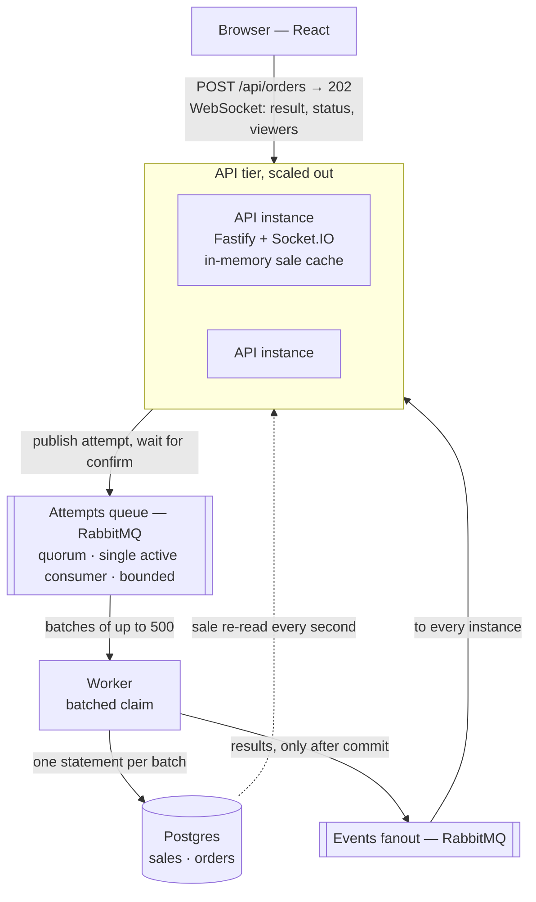
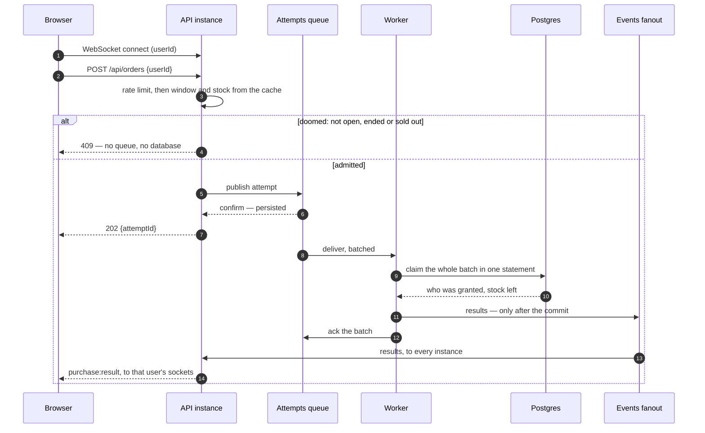

# flash-sale

A flash sale for one limited-stock product, one unit per buyer, built to stay correct and responsive under a stampede: purchases are queued and settled in batches by a single worker, and each buyer learns the outcome over a WebSocket.

On one laptop it holds **10 000 purchase attempts per second** through a sellout and sells **exactly** its stock — 20 000 units, with every confirmation a buyer heard matched to a committed order in the database afterwards. A buyer hears back in **~10 ms** at the median when it is quiet (p99 31–45 ms); with every attempt a real claim, the median is 22–43 ms but the p99 misses its 100 ms target on one laptop running everything ([stress tests](#stress-tests)).

`docs/REQUIREMENT.md` is the brief. `docs/PLAN.md` is the full design and its reasoning; this README is the summary a reviewer needs, and links into it.

- [Running it](#running-it)
- [System design](#system-design)
- [Design choices and trade-offs](#design-choices-and-trade-offs)
- [Robustness](#robustness)
- [Scalability](#scalability)
- [Testing](#testing) — including [stress results](#stress-tests)
- [Reference](#reference) — API, realtime events, vocabulary
- [Known limitations](#known-limitations)
- [Repository](#repository)

## Running it

Needs Node ≥ 24, pnpm (`corepack enable`), and a Postgres and RabbitMQ — your own, or Docker's.

**With Postgres and RabbitMQ already running locally**, using their stock credentials (passwordless `postgres`, RabbitMQ's `guest`):

```sh
pnpm install
pnpm dev        # http://localhost:5173
```

That is the whole setup: it creates the database, migrates, seeds a sale, builds, and runs the API, worker and web dev server with labelled output. Ctrl-C stops everything. Point it elsewhere with `DATABASE_URL` / `RABBITMQ_URL`, in the shell or a `.env`.

**With nothing but Docker**, the built app, as it would ship:

```sh
docker compose --profile app up -d --wait
open http://localhost:8080
```

**Tests:**

```sh
pnpm verify                              # format, lint, typecheck, unit + integration, licences, audit
pnpm exec playwright install chromium    # once
pnpm test:e2e                            # Playwright, against a stack it starts itself
pnpm stress sale                         # k6, against a stack it starts itself — see Stress tests
```

Each of these runs in its own environment — its own database and queues — so they run side by side with `pnpm dev` on one Postgres and one broker. [`docs/DEVELOPMENT.md`](docs/DEVELOPMENT.md) covers the environments, using the Compose services, running the built app by hand, deploying behind a gateway, and the devcontainer.

## System design



- **API** (Fastify + Socket.IO). Turns away what it can from memory — outside the sale window, sold out, over the rate limit — publishes the rest to RabbitMQ and waits for the broker's confirm, then answers `202`. Holds each buyer's WebSocket. Stateless apart from its sockets, so it scales out; it also serves the built frontend on the same origin.
- **RabbitMQ.** Carries purchase *attempts* — requests, not decisions — on a durable, length-bounded quorum queue with a single active consumer, and carries results and presence back on a fanout exchange to every API instance.
- **Worker.** The only writer. Takes attempts in batches and settles each batch in one SQL statement, then publishes the results — after the commit, never before.
- **Postgres.** The system of record, and the last line of defence: its constraints make an oversell or a double grant impossible to store, even if the code were wrong.

### A purchase, step by step



The `202` means *accepted*, not *bought*: the answer comes over the socket, typically within tens of milliseconds. If the socket drops or the page is refreshed in between, the page recovers the outcome from `GET /api/orders?userId=` and its own record of the attempt it is waiting on (see [Robustness](#robustness)).

### Where each rule is enforced

| Rule | Enforced by | Backstop if the code were wrong |
| --- | --- | --- |
| **Limited stock** | The claim locks the sale row and decrements by the number of orders it actually inserted, in one statement ([`claim.ts`](apps/worker/src/claim/claim.ts)) | `CHECK (remaining >= 0)` |
| **One unit per buyer** | `INSERT … ON CONFLICT (sale_id, user_id) DO NOTHING` in the same statement | `UNIQUE (sale_id, user_id)` |
| **The sale window** | The claim checks the window under the same lock; the API also turns early and late attempts away from its cache | — |
| **Never a false "yes"** | Results are published only after the transaction commits; the batch is acked only after that | A redelivered batch is a no-op: everyone in it already holds their order, so nothing is inserted and nothing decremented |

## Design choices and trade-offs

Each is argued at length, with measurements, in `docs/PLAN.md`.

1. **Asynchronous purchase: `202`, then the answer over a WebSocket** (PLAN §3). A synchronous claim per request means every request holds a database lock — measured as a lock convoy at 899 claims/s with 55 ms mean latency. Queueing turns the stampede into an orderly line. *The cost:* the client must handle an answer that arrives separately — reconnects, refreshes, renames and several tabs all have to be designed for, and are tested. Holding the request until the worker replies was considered and not taken: under a full queue or a database outage the wait has no useful bound, so the separate-answer path would be needed anyway (PLAN §2.2).

2. **One worker, settling claims in batches** (§4). A single active consumer means there is no race to arbitrate: correctness comes from the topology, not from locking. Batching is what makes one worker fast enough — 835 claims/s one at a time, ~37 000–41 500/s at 100 per single-statement transaction, because the fsync per commit is amortised. Batches go up to 500 (`CLAIM_BATCH_MAX`): under light load the 5 ms timer flushes first, so large batches only form in a rush, when throughput is what counts. *The cost:* that one consumer is the throughput ceiling (see [Scalability](#scalability)).

3. **A stock counter row, not a pool of unit rows** (§16 q5). Both were measured. The counter is simpler and batches better; a pool gives each unit a lifecycle, which only matters once there is a payment step with reservations (§15.2). Decided counter, with the switch point written down.

4. **The queue and Postgres decide; no cache decides** (§3). A Redis script granting stock is faster, but then a grant exists before it is durable, and a crash in that window tells a buyer "yes" while they hold nothing. Here a result is only ever published after the commit. *The cost:* RabbitMQ is a hard dependency — mitigated by a quorum queue on a three-node cluster in production (§5.1).

5. **Postgres over MongoDB** (§3), on measurement: 3–7× faster at equal fairness, and MongoDB has no `FOR UPDATE SKIP LOCKED` equivalent.

6. **Turn away doomed traffic at the API, from memory** (§6). Each API instance re-reads the sale every second and refuses attempts outside the window or after sellout without touching the queue or the database. In the stress run, 208 000 of 233 000 attempts were answered this way. *The cost:* for up to a second after sellout, attempts are still queued — and then rejected by the worker. The cache can only be wrong in that harmless direction.

7. **Results reach the right socket by fanout, not by a shared registry** (§8). Every API instance receives every result and delivers to the sockets it holds. No Socket.IO adapter, no user-to-instance map; the extra fan-out is bounded by the request rate.

8. **The API serves the frontend** (§12.1). One origin, one image for the API. Routing between SPA and API is left to whatever is in front — a gateway, a CDN, the Vite proxy in development — rather than baked into an nginx image.

9. **The pending attempt lives in the browser** (`usePendingAttempt`). Only the browser that sent an attempt needs to know it is pending, and recording it server-side would put a write on the one request path kept free of them. *The cost:* "pending" does not follow a buyer to another device — harmless, since the server allows one order per buyer regardless.

10. **An environment per run** (`APP_ENV`). Development, test, E2E and stress each get their own database and queue names on shared services, so none can consume another's purchases.

## Robustness

| Failure | What happens |
| --- | --- |
| Worker dies mid-batch | The transaction rolls back; the messages were never acked, so they are redelivered to the standby worker, which the broker promotes. |
| Worker dies after commit, before ack | The batch is redelivered; the claim inserts nothing for buyers who already hold an order, so it is a no-op. |
| API instance dies | Its sockets drop; clients reconnect to another instance and re-sync their order from `GET /api/orders`. Queued attempts are unaffected. |
| A result is lost — socket down, or page refreshed mid-purchase | The page looks the buyer's order up every time its socket connects; on a refresh it restores the attempt it was waiting on. A lost win is found by that lookup; a lost rejection is settled from the sale once it has sold out or ended, and an attempt nobody decides is let go after two minutes. A lookup that fails — rate limited, a server error, no network — is retried, never read as "no order", so a winner is never told they lost. Buy stays disabled until the socket is connected, so no result is decided before there is somewhere to send it. |
| Postgres down | The worker holds its batch unacked and retries it with backoff; the broker stops delivering, the queue fills to its bound, then the API sheds with `503`. When Postgres returns, every accepted attempt is claimed. Verified: 20 attempts accepted during an outage, all 20 orders once it ended. |
| Traffic beyond capacity | The queue is bounded; past it the API answers `503` immediately instead of queueing without limit. Measured: every accepted attempt still became an order. |
| A broker node dies | (Production topology.) The quorum queue elects a new leader within seconds; a confirm means a majority already held the message. |
| Connection to the broker lost | The API and worker exit and their restart policy brings them back; unacked attempts are redelivered and clients re-sync. Verified by restarting RabbitMQ under the Compose stack. |
| An attempt that can never be claimed | Goes to the `<queue>.dead` queue for an operator, never nowhere: a malformed message; one redelivered past the delivery limit of 20 (20 worker deaths holding it); or one carrying data Postgres refuses, such as a NUL byte, whose batch is split until it is alone so the others are still claimed. The API also refuses a `userId` with control characters before it is queued. |

The property under all of it: **nobody is told "confirmed" unless the order is committed.** An outage is honest; a false confirmation is not, and the design trades availability for that (PLAN §5).

## Scalability

- **The API scales out** freely — it holds nothing but its sockets — and absorbs the bulk of a rush on its own, from memory.
- **The worker is deliberately singular**, and is the ceiling: ~44 000 claims/s for the worker path in isolation at batches of 500, and ~18 000 attempts/s on the queue path in the shared-laptop stress run when every attempt is a winner — where k6, not the worker, ran out first. Beyond it the system sheds rather than slows.
- **The next 10×** (PLAN §15.1): shard the stock into K rows with one consumer each, routed by buyer; or put a fast admission filter ahead of the queue that lets only potential winners through. Neither requires changing the claim.

## Testing

| Layer | What | Run |
| --- | --- | --- |
| Unit + integration | 194 tests. The invariants through the real queue and worker: 2 000 attempts for 50 units, a quarter repeats, yield exactly 50 orders, one answer per attempt, and **confirmed results equal to the orders**; a worker **killed between commit and ack** has its batch replayed as the same order, stock moved once. The claim alone under concurrency: **never oversells** (20 000 attempts against 1 000 units) and **never grants one buyer two units**. Redelivery, dead-lettering and failure handling against a real RabbitMQ; API routes; realtime delivery; the frontend's purchase-state rules | `pnpm test` |
| End to end | 23 Playwright specs against the built app | `pnpm test:e2e` |
| Stress | k6 scenarios, then the invariants checked in Postgres | `pnpm stress <scenario>` |

CI runs the first two on every pull request — the unit suite twice, once in a non-UTC timezone, since a suite that only passes in UTC cannot catch code that depends on the local zone.

The oversell test asserts on grants *returned to callers*, not only on rows: `docs/prototype/postgres-pool/` holds a claim that oversells 9.5× while leaving the table looking perfect.

### End-to-end tests

Playwright drives real browsers against a stack it starts itself (the API serving the built frontend, plus a worker). Each spec reseeds the sale through a reset endpoint that exists only in the E2E environment. No retries: a flaky suite trains people to re-run red builds.

| Spec | Proves |
| --- | --- |
| `purchase` | click → `202` → a visible *queued* state → the result over the socket → held |
| `reconnect` | a result lost with a dropped socket is recovered after reconnecting |
| `refresh` | a refresh mid-purchase keeps it, and the outcome still lands — the order, or *sold out* |
| `concurrency` | five buyers race for two units: two hold, three see *sold out* |
| `presence` | the viewer count follows people arriving and leaving |
| `lifecycle` | *upcoming → active → ended*, live, with no reload — also for a visitor who has not typed a name |
| `time` | one instant shown in Tokyo and St John's, each labelled; a browser clock two hours fast leaves the countdown right |
| `rejection` | not yet open, ended, already held, `503`, `429` — each ends in a message |
| `double-click` | exactly one attempt sent |
| `stuck` | a purchase never sits on *Securing* for good: a rejection that never arrives settles at sellout or at the end, including one that sold out while the socket was down; Buy waits for the socket; a rename neither carries an attempt over nor loses it; and a winner whose result is lost, and whose lookups are rate limited, still ends up holding their order |

### Stress tests

```sh
pnpm stress sale        # an oversubscribed sale: latency, the rush, the invariants
pnpm stress shedding    # past the queue bound: clean 503s, nothing accepted lost
pnpm stress load        # a buyer's wait while every attempt is a real claim
pnpm stress capacity    # exploratory: the ceiling with every attempt queued
```

Each run builds the app and starts its own stack with **two API instances** — a buyer's socket on one, their `POST` on the other, so every result crosses instances. [k6](https://k6.io) drives the load from Docker, standing in for many clients, each with its own address so the rate limiter sees them as distinct. Afterwards the run checks the invariants **in Postgres** and prints `PASS`/`FAIL` for each, because a load test that only reports throughput proves nothing. Stress is not in CI: sustained load on a shared runner is noise.

**Expected outcome** — every correctness line `PASS`. Measured on one laptop (Ryzen 5 7640U, 12 threads, 30 GB) running k6, both APIs, the worker, Postgres and RabbitMQ together. `sale` runs two phases: `steady` (300 buyers/s on the socket) and then `rush` (HTTP only, ramped to 10 000/s and held 20 s, a quarter of it repeat buyers). `load` holds a rate of attempts against stock that never sells out — every one a real claim — while `probe` buyers on the socket are timed throughout. Each phase is reported on its own, with how many results it timed; none is pooled with another.

| Scenario | Target (PLAN §2.3) | Measured |
| --- | --- | --- |
| `sale` correctness: 20 000 units, 11.9× offered, ~1.35× reaching the queue | no oversell, no double grant, no false answer | **in all six runs:** 20 000 orders, stock 0; every accepted attempt answered exactly once; the confirmed set *equal* to the orders; no buyer told anything but their own outcome |
| `sale` rush, the rate | ≥ 10 000 attempts/s sustained | **held for 20 s**, 0 dropped, 0 failed; `POST` p99 13–29 ms |
| `sale` steady, `POST` → result, before the rush | p99 < 100 ms | p50 9–10 ms, p95 23–31 ms, **p99 31–45 ms** |
| `load` — every attempt a real claim, `POST` → result | p99 < 100 ms | **not met under real load here.** p50 22–43 ms at every rate. p95 45–69 ms up to 7 500/s. p99 199–597 ms at 2 500–7 500/s; at 10 000/s, 89 ms to 1.5 s across four runs |
| `load` — the rate held | ≥ 10 000 attempts/s | 2 500/s held; 5 000–7 500/s within ~1% of plan; at 10 000/s, 1–5% of attempts dropped by k6 |
| `load` — correctness, every run | every accepted attempt an order | **every accepted attempt claimed, answered exactly once and confirmed** — up to 229 087 a run |
| `shedding` — worker stopped, 5 000/s against a bound of 2 000 | clean rejection, nothing lost | 47 918 shed with `503`; **all 2 005 accepted became orders**; API memory +41 MB |
| `capacity` — ramped to 20 000/s offered, stock that never sells out | — | **~18 000/s sustained through the queue**, nothing shed; k6 could not offer more |

**Reading the results:**

- **The correctness checks are the strong ones.** The orchestrator listens to every result the worker announces, the way an API instance does, and holds each against Postgres: the set of confirmed `(buyer, order)` pairs must *equal* the orders, every accepted attempt must get exactly one answer, and a buyer holding an order must never hear anything else. Earlier versions checked `confirmed ≤ orders` and `buyers = orders`, which the `UNIQUE` constraint already guarantees and so could not fail.
- **The rush is held at the API, and the claim sees little of it.** 11.9× stock is *offered*, but once stock is gone the in-memory cache refuses the rest: ~1.35× stock reaches the queue — the winners, plus those arriving within the cache's one-second refresh. That is the design, but it also means the queue and claim are oversubscribed ~1.35×, not 12×.
- **`sale`'s rush is not a latency test.** It sells out within seconds, after which almost every attempt is refused from memory, so its 10 000/s is mostly `409`s answered without touching the queue. An earlier version timed buyers during it and quoted that as the wait under 10 000 attempts/s; there were only a few hundred samples, all from before sellout (issue #17). `load` is the honest test.
- **Under real claim load, the 100 ms p99 target is not met on this laptop.** With every attempt a claim, a buyer's median wait is 22–43 ms and the p95 stays under 70 ms up to 7 500/s — but the p99 runs from ~200 ms to well past a second, and does not track the rate: 2 500/s gave 199–237 ms, one 10 000/s run 89 ms. `POST` alone already has a p99 over 100 ms at 2 500/s, before the queue is involved, so the tail is mostly six processes contending for twelve threads — k6, two APIs, the worker, Postgres and RabbitMQ. One machine cannot separate those; meeting the target under load needs the components on their own hosts, and measuring there. Vacuuming the orders table before each run, to rule out cleanup of the last run's rows, made no difference.
- **The queue path's own ceiling is lower,** but above what this laptop can offer: ~18 000 attempts/s when every attempt wins. At batches of 100 the same run topped out at ~8 000/s and shed 241 000 attempts; at 500 it shed none. Past its ceiling the system degrades by shedding with `503`, not by losing purchases — `shedding` proves it.
- **The queue's bound is approximate** with two instances publishing at once (2 005 accepted for 2 000). What matters holds: it stops growing, and nothing accepted is lost.
- **The first run found a real bug.** The worker drained at ~4 000 claims/s against ~35 000 for the claim alone: Nagle's algorithm held each batch's ack ~20 ms behind its result publish. With it off (`connectBroker`), the same drain runs at ~33 000/s.

k6 is AGPL-3.0. It runs as a separate program driving the API over the wire, never linked into or shipped with this code — the same position as Postgres and RabbitMQ under the licence rule in `CLAUDE.md`.

## Reference

### API

Interactive docs at **`/docs`** (OpenAPI at `/docs/json`), generated from the same route schemas Fastify validates with.

| Method | Path | Returns |
| --- | --- | --- |
| `GET` | `/api/sale` | status, coarse availability, window, `serverTime` — served from memory |
| `POST` | `/api/orders` | create: `202` with `attemptId` once the broker confirms, `Location` → the buyer's orders · `409` not open / ended / sold out · `429` · `503` |
| `GET` | `/api/orders?userId=` | index, filtered by buyer: `[]` or their one order · `400` without the filter · `429` past the per-address limit |
| `GET` | `/healthz` `/readyz` | live once up; ready once the sale is loaded |

Orders are a REST resource with `create` and a filtered `index`. `create` answers `202 Accepted`, not `201 Created`, because the order is decided asynchronously. The lookup is a filtered `index` rather than a `show`, because a reconnecting client knows the buyer, not the order id; the filter is required, since unfiltered it would list every buyer to anyone.

### Realtime

Clients connect a Socket.IO socket identifying the buyer — or no one yet, before a name is typed: such a socket gets the sale's status and the viewer count, and counts as a viewer, but no results. They receive:

| Event | When |
| --- | --- |
| `purchase:result` | an attempt is settled: `confirmed`, `already_purchased`, `sold_out`, `not_started` or `ended` |
| `sale:status` | on connect, and whenever status or availability changes |
| `sale:viewers` | on connect and every few seconds: how many people are looking |

Results go to **every** socket of the buyer, on every instance — so a buyer's other tabs learn of the order too. Two tabs attempting at once see `confirmed` and `already_purchased`, both carrying the same `orderId`; the page keys on that.

### Vocabulary

| Word | Means |
| --- | --- |
| **purchase** | the act: what *Buy now* does, asking for an order |
| **attempt** | one queued request a purchase produces; it may or may not succeed |
| **result** | the worker's decision on an attempt |
| **order** | the row a successful attempt leaves — the only durable proof of a sale |

## Known limitations

- **No authentication.** A buyer is whatever name they type; the brief asks for an identifier, not accounts. The order lookup requires a buyer filter so it cannot list everyone. It follows that **anyone can watch anyone**: a socket connected as a name receives that buyer's results and order id, and the lookup answers for any name. A verified session would key both.
- **Rate limits are per API instance**, so N instances allow N× the configured rate. A shared counter would put a store on every request; the bounded queue and the claim are what actually protect the sale. The order lookup is limited per address too, but a limit cannot stop many clients at once: an instance dying sends all its clients to re-sync together, spread only by Socket.IO's randomised reconnect backoff — each a single index probe.
- **The viewer count is approximate** — it converges within a few seconds, and a buyer connected to two instances counts twice. It is decorative.
- **One broker locally.** Production would run the quorum queue on a three-node cluster (PLAN §5.1); Compose runs one node to keep the first run fast.
- **One sale at a time**, configured by `SALE_ID`.

## Repository

| Path | What it is |
| --- | --- |
| `apps/api` | Fastify API and Socket.IO gateway; serves the built frontend |
| `apps/worker` | Queue consumer and the batched claim; migrations and seed |
| `apps/web` | React frontend (Vite) |
| `packages/core` | Contracts and rules shared with the browser |
| `packages/messaging` | RabbitMQ topology, publishing and consuming — server only |
| `tests/` | `integration/`, `e2e/` (Playwright), `stress/` (k6) |
| `scripts/` | `pnpm dev`, the E2E and stress orchestration, the licence gate |
| `docs/` | `PLAN.md` (design), `DEVELOPMENT.md`, `prototype/` (the spikes behind the measurements) |

| Command | Does |
| --- | --- |
| `pnpm dev` | the whole stack, with watching |
| `pnpm verify` | everything CI's gate runs: format, lint, typecheck, tests, licences, audit |
| `pnpm test` / `pnpm test:e2e` / `pnpm stress <scenario>` | the three test layers |
| `pnpm build` | TypeScript project build, then the web bundle |
| `pnpm migrate` / `pnpm seed` | schema, and a sale to buy from |

Housekeeping rules live in `CLAUDE.md` and are enforced in CI: lint and format gate every commit, no copyleft or known-vulnerable dependencies, every instant UTC until the browser localises it.
