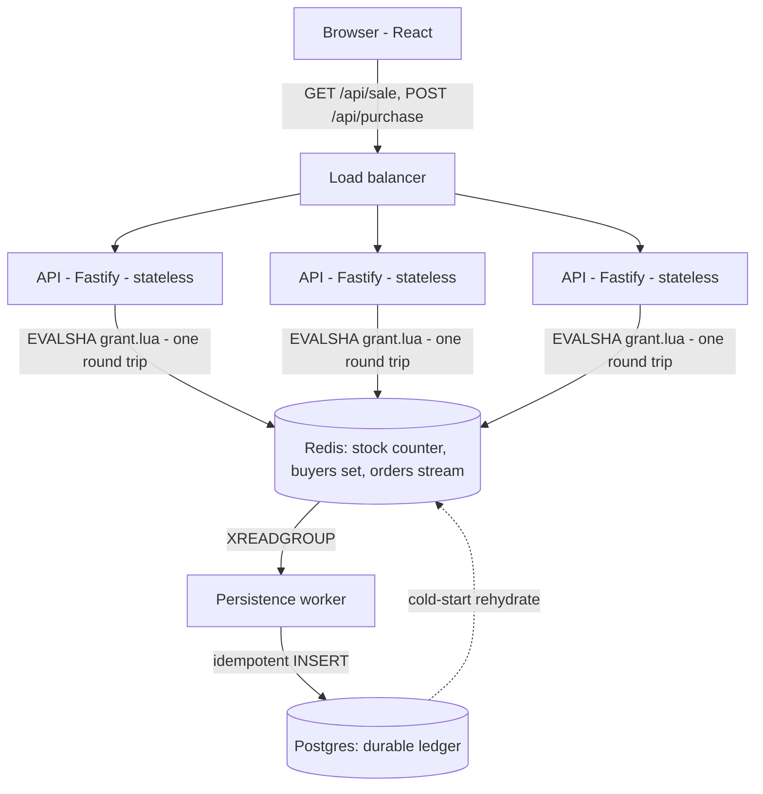

# Flash Sale — Requirement Analysis & Implementation Plan

Companion to [REQUIREMENT.md](./REQUIREMENT.md). This is the plan I intend to build against; the final `README.md` will be derived from the decisions recorded here.

## 1. What is actually being assessed

The brief is small enough to brute-force with a single Postgres row and a `SELECT ... FOR UPDATE`. That would pass the functional tests and fail the exercise. The grading criteria name *System Design*, *Correctness under load*, *Testing*, and *Pragmatism* — so the deliverable has to make three things visible:

1. **One serialization point, and it is cheap.** Every purchase must funnel through a single atomic decision. The design question is not *whether* to serialize but *where*, and how few microseconds it costs.
2. **A failure story.** What breaks when the box holding that decision dies, and whether the breakage is oversell (unacceptable — you sold stock you do not have) or undersell (acceptable — stock returns, the user retries).
3. **Tests that prove the invariant, not tests that exercise the happy path.** A stress test reporting "12k req/s, 0 errors" proves nothing. One that asserts `successes === stock` exactly, under 20× oversubscription, proves everything.

Everything below optimises for making those three legible.

## 2. Requirement analysis

### 2.1 Functional, restated as invariants

| # | Requirement | Invariant to enforce | Where enforced |
|---|---|---|---|
| 1 | Configurable sale window | No grant outside `[startAt, endAt)` | Atomic script (single clock) |
| 2 | Single product, limited stock | `count(orders) <= totalStock`, always | Atomic script + DB check |
| 3 | One item per user | `count(orders where user) <= 1` | Atomic script + `UNIQUE (sale_id, user_id)` |
| 4 | API: status / purchase / check | — | Fastify HTTP layer |
| 5 | React frontend | — | Vite + React |
| 6 | System diagram | — | Mermaid in README |

Invariants 2 and 3 get **two independent enforcers**: the fast path (Redis) for throughput, and a durable database constraint as the backstop. If the fast path is ever wrong, the database refuses the write and we get an alert instead of an oversold product. That redundancy is deliberate and worth calling out in the README.

### 2.2 Ambiguities, and the decisions I am taking

The brief leaves these open. Each is a defensible judgement call; the README will state the choice and the reason.

- **Is there authentication?** No. `userId` is a client-supplied string, exactly as the brief's frontend description implies ("enter a user identifier"). The one-per-user rule is therefore enforced *per identifier*, not per human. I will say so explicitly rather than pretend otherwise, and note that in production this key would come from a verified session.
- **Is "already purchased" an error?** No — it is a success. Because each user may hold at most one item, `userId` is a natural idempotency key: a retried or duplicated `POST /purchase` returns the *same* order. This makes the endpoint safely retryable, which matters because the first thing a panicking user does is double-click. Returns `200` with `status: "already_purchased"` and the existing order id.
- **Is stock exposed?** Exact remaining stock is a poll magnet and leaks sale mechanics. The status endpoint returns a coarse `availability: "plenty" | "low" | "sold_out"`, not a live counter. Cheap, and it removes the incentive to hammer the endpoint.
- **Whose clock decides the window?** Redis's. See §4.
- **Reservation or sale?** A grant is final, not a held reservation. There is no payment step in the brief, so introducing a TTL'd reservation that can expire adds a whole class of states ("expired, stock returned") the requirement never asks for. Out of scope, mentioned as an extension.

### 2.3 Non-functional targets

Concrete numbers, so the stress test has something to pass or fail:

- **Throughput:** ≥ 10k purchase attempts/sec sustained on a laptop-scale docker-compose, single Redis.
- **Latency:** p99 < 50 ms for `POST /purchase` under full load.
- **Correctness:** zero oversell and zero double-grant at any load. Non-negotiable; this one gets asserted, not merely measured.
- **Availability:** API instances are stateless and disposable; killing one mid-test loses only its in-flight requests.

## 3. Architecture



**Request path, in full:** load balancer → stateless Fastify instance → *one* `EVALSHA` to Redis → response. That is a single network hop on the hot path. No database on the purchase path at all.

**Component roles:**

- **API (Fastify, TypeScript).** Validation, rate limiting, and one Redis call. Holds no sale state beyond a short-lived cache (§6). Scales horizontally to N replicas with zero coordination.
- **Redis.** The authority for the grant decision. Single-threaded command execution is the property the whole design leans on: a Lua script is an atomic unit, so "is the sale open / has this user bought / is there stock / take one" is one indivisible step. No locks, no transactions, no retries, no race.
- **Orders stream (Redis Stream).** The handoff to durability. Critically, the `XADD` happens *inside the same Lua script* as the decrement — so a grant and its persistence request are written atomically, in one system. There is no window where stock was taken but nothing was queued.
- **Persistence worker.** A consumer-group reader draining the stream into Postgres with at-least-once delivery and an idempotent upsert. Can crash and resume; unacknowledged entries are redelivered.
- **Postgres.** The durable ledger and the system of record for reporting and recovery. Never on the purchase hot path.

**Why not the obvious alternatives** (the README will carry a condensed version of this):

| Approach | Why not |
|---|---|
| `UPDATE stock SET n = n - 1 WHERE n > 0` in Postgres | Correct, but every buyer contends on one row. Under thousands of concurrent writers this becomes a lock convoy — throughput collapses and p99 goes to seconds. Fine at 100 rps, not at 10k. |
| Application-level mutex / in-process counter | Breaks the moment there is more than one API instance, which is exactly the scalability the brief asks for. |
| Optimistic concurrency with retries (CAS loop) | Under heavy contention almost every attempt retries; wasted work grows with load, which is backwards. |
| Queue everything, decide in a single consumer | Correct and genuinely scalable, but the user cannot be told the outcome synchronously — it needs polling or websockets and a far more complex frontend. The Lua script gets the same serialization for a fraction of the complexity. Worth citing as the design for a sale 100× larger. |

## 4. The critical path: one atomic grant

This script is the core of the submission and is where review attention will land, so it gets written first and tested hardest.

```lua
-- KEYS[1] = sale:{id}:stock   (integer string)
-- KEYS[2] = sale:{id}:buyers  (set of userId)
-- KEYS[3] = sale:{id}:orders  (stream)
-- KEYS[4] = sale:{id}:window  (hash: startAtMs, endAtMs)
-- ARGV[1] = userId
-- ARGV[2] = orderId (uuid v4, generated by the caller)

local t     = redis.call('TIME')
local now   = (tonumber(t[1]) * 1000) + math.floor(tonumber(t[2]) / 1000)
local w     = redis.call('HMGET', KEYS[4], 'startAtMs', 'endAtMs')
local start = tonumber(w[1])
local stop  = tonumber(w[2])

if start == nil then return {'NOT_CONFIGURED', ''} end
if now <  start then return {'NOT_STARTED', ''} end
if now >= stop  then return {'ENDED', ''} end

-- Idempotency: a repeat attempt is a success, and must not consume stock.
if redis.call('SISMEMBER', KEYS[2], ARGV[1]) == 1 then
  return {'ALREADY_PURCHASED', ''}
end

local remaining = tonumber(redis.call('GET', KEYS[1]) or '0')
if remaining <= 0 then return {'SOLD_OUT', ''} end

redis.call('DECR', KEYS[1])
redis.call('SADD', KEYS[2], ARGV[1])
redis.call('XADD', KEYS[3], '*',
           'orderId', ARGV[2], 'userId', ARGV[1], 'atMs', tostring(now))

return {'CONFIRMED', ARGV[2]}
```

Four details that matter, each of which I expect to be asked about:

1. **All checks and all mutations are in one script.** Redis runs it to completion before any other command. There is no interleaving, so there is no need for a compensating rollback — the alternative shape (`SADD` first, then discover stock is gone, then `SREM`) is a bug factory, and is avoided entirely by reading before writing inside the atomic unit.
2. **`TIME` comes from Redis, not the API process.** With N API instances the window boundary would otherwise be decided by N clocks with skew between them, and the sale would start and end at slightly different moments depending on which pod you hit. One clock, one boundary.
3. **Non-deterministic commands are safe here.** `TIME` and `XADD *` would be unreplayable under verbatim script replication, but Redis ≥ 5 replicates script *effects*, so a replica receives the concrete values. Worth a comment in the source so it does not look accidental.
4. **`orderId` is generated by the caller.** Keeps the script free of randomness and makes the id available to the response without a second round trip.

**This script is already verified.** A throwaway spike in [`prototype/`](./prototype/) runs it against a real Redis 8 over 50 concurrent pipelined connections and asserts the invariants directly. All pass:

| Scenario | Result |
|---|---|
| Stock 1000, 20 000 distinct users | exactly 1000 `CONFIRMED`, 19 000 `SOLD_OUT`; stock 0, buyers 1000, stream 1000 |
| Stock 1000, 1000 attempts from **one** user | exactly 1 `CONFIRMED`, 999 `ALREADY_PURCHASED`; stock decremented by exactly 1 |
| Before start / after end | `NOT_STARTED` / `ENDED`, zero stock consumed |
| Unconfigured sale | `NOT_CONFIGURED`, no partial writes |
| Sold out mid-flight | losers are **not** added to the buyers set, so a restock does not lock them out |

Throughput: **20 000 grants in 95 ms — ~210 000 ops/s** against a single unoptimised local Redis. That is a useful anchor for the rest of the design: the grant decision is roughly 20× cheaper than the 10k/s target in §2.3, which means the bottleneck will be HTTP handling and the network, not the serialization point. Scaling effort belongs on the API tier, not on Redis.


## 5. Durability and failure modes

This is the section the design stands or falls on, so the README will be blunt about it rather than claim guarantees the system does not have.

| Failure | Behaviour | Severity |
|---|---|---|
| API instance dies | LB routes elsewhere. In-flight requests fail; the client retries and the request is idempotent on `userId`. | None |
| Worker dies | Stream entries go unacknowledged and are redelivered to the next consumer. Grants are unaffected — the user already has a confirmed answer. | None |
| Postgres down | Worker stalls and retries with backoff; the stream buffers. The sale keeps serving. Reads of `/purchase/:user` fall back to Redis. | Degraded, self-healing |
| Redis loses its last second of writes (AOF `everysec`, hard crash) | Those grants vanish: the user was told "confirmed" but holds no order. Stock and the buyer entry vanish *together*, so they retry and can buy again. | **Undersell, never oversell** |
| Redis lost entirely | Cold-start rehydrate from Postgres: `stock = totalStock - count(orders)`, `buyers = select user_id from orders`. | Undersell bounded by the unpersisted tail |

The asymmetry is the point: **every failure path degrades towards undersell.** Stock and the buyer-set entry are written in the same atomic unit, so they can never diverge in the direction that lets two people hold the same unit — and the durable ledger's `UNIQUE (sale_id, user_id)` plus a stock check mean even a logic bug cannot persist an oversell.

Configuration: `appendonly yes`, `appendfsync everysec`. `always` would make the crash window zero at a large throughput cost; for a flash sale, a ≤1s window that can only cause undersell is the right trade, and I will say so explicitly. Closing it entirely needs either a synchronous replica (`WAIT 1 0`) or a synchronous DB write — both on the table, both costly, both documented as the knob to turn if the business disagrees.

## 6. API surface

| Method | Path | Returns |
|---|---|---|
| `GET` | `/api/sale` | `{ status: upcoming\|active\|ended, availability: plenty\|low\|sold_out, startAt, endAt, serverTime }` |
| `POST` | `/api/purchase` | `200 { status: confirmed\|already_purchased, orderId }` · `409 { status: sold_out\|not_started\|ended }` · `429` |
| `GET` | `/api/purchase/:userId` | `{ status: none\|confirmed, orderId?, purchasedAt? }` |
| `GET` | `/healthz` `/readyz` `/metrics` | liveness, readiness, Prometheus |

Two throughput decisions live here:

- **`GET /api/sale` must not touch Redis per request.** It is by far the highest-volume endpoint — every open tab polls it. Each API instance caches the sale state in-process and refreshes it on a ~250 ms timer. Status is not a correctness-critical read; being 250 ms stale is harmless, and this keeps the poll storm entirely off Redis. `serverTime` is returned so the frontend can run a countdown without trusting the client clock.
- **Sold-out short-circuit.** In a real flash sale most traffic arrives *after* the stock is gone. Once an instance observes a confirmed sellout it rejects locally without calling Redis. This is a cache, so it may only short-circuit a *rejection*, never grant without the script. The refresh timer resets it, so a restock recovers automatically.

Rate limiting: per-IP and per-userId token bucket in Redis, rejecting early with `429`. Abuse is not in the brief, but an endpoint this attractive without a limiter is an obvious omission.

## 7. Data model

```sql
CREATE TABLE sales (
  id          TEXT PRIMARY KEY,
  total_stock INTEGER NOT NULL CHECK (total_stock >= 0),
  start_at    TIMESTAMPTZ NOT NULL,
  end_at      TIMESTAMPTZ NOT NULL,
  CHECK (end_at > start_at)
);

CREATE TABLE orders (
  id         UUID PRIMARY KEY,
  sale_id    TEXT NOT NULL REFERENCES sales(id),
  user_id    TEXT NOT NULL,
  created_at TIMESTAMPTZ NOT NULL DEFAULT now(),
  UNIQUE (sale_id, user_id)          -- the durable one-per-user backstop
);
CREATE INDEX ON orders (sale_id);
```

The sale window and stock live in `sales` (satisfying "configurable"), are loaded into Redis at boot, and `orders` is the ledger the worker appends to. The worker's insert is `ON CONFLICT (sale_id, user_id) DO NOTHING`, which makes at-least-once stream redelivery harmless.

Oversell cannot be persisted even in principle: a count check against `total_stock` runs in the worker, and a violation is logged loudly and alerted rather than silently dropped — a trip of that path means the fast path has a bug, and I would rather find out.

## 8. Frontend

Deliberately small — the brief asks for a demonstration, not a storefront. Vite + React + TypeScript, one page:

- Sale status with a countdown driven off `serverTime`, not the browser clock.
- A `userId` input, persisted to `localStorage` so a refresh does not lose your identity.
- A "Buy Now" button, disabled outside the active window, with an in-flight state that blocks the double-click rather than relying on the server's idempotency to absorb it.
- Clear terminal states: *confirmed* (with order id), *already purchased*, *sold out*, *not started*, *ended*.
- On mount it calls `/api/purchase/:userId`, so returning users see their existing order immediately.

Polling `/api/sale` every 2 s. SSE would be nicer and avoids the poll storm, but polling against an in-process-cached endpoint is cheap, and the complexity budget is better spent on the concurrency core. Noted as an extension.

## 9. Testing strategy

Three layers, with the middle one carrying most of the weight.

**Unit (Vitest).** Pure domain logic: status derivation from a window, response mapping, the sold-out cache state machine. Fast, no I/O.

**Integration (Vitest + real Redis and Postgres via docker-compose).** The Lua script against a live Redis, and the API via Fastify's `inject`. Mocking Redis here would test the mock, not the script — and the script *is* the concurrency control, so it gets exercised against the real engine. Covers each terminal state, window boundaries, and worker → Postgres persistence including redelivery.

**The two decisive tests.** These assert the invariants directly and run in CI, not just by hand. The [`prototype/`](./prototype/) spike already implements both against a raw socket client; they get ported to Vitest and re-pointed at the HTTP API so they exercise the whole stack rather than Redis alone:

1. *No oversell.* Stock = 1000. Fire 20 000 concurrent purchases from 20 000 distinct users. Assert exactly 1000 `confirmed`, exactly 19 000 `sold_out`, zero 5xx — and, after the worker drains, exactly 1000 rows in `orders`.
2. *No double-grant.* Stock = 1000. Fire 1000 concurrent purchases from **one** user. Assert exactly one order, and stock decremented by exactly one.

**Stress (k6).** The headline run: ramp to high concurrency over ~60 s against docker-compose, with thresholds encoded as pass/fail (`http_req_failed < 1%`, `p(99) < 50ms`), and a teardown that queries the API and the database to assert the same invariants at realistic load. k6 over autocannon because scenarios and thresholds make the run self-judging rather than a wall of numbers to interpret in prose. A small autocannon script stays in the repo as a zero-extra-tooling fallback.

Results — throughput, latency distribution, and the invariant assertions — get written into the README with an explanation of what the numbers mean and where the next bottleneck would appear.

## 10. Repo layout and tooling

```
apps/
  api/        Fastify server, routes, rate limiting, grant client
  worker/     stream consumer -> Postgres
  web/        Vite + React frontend
packages/
  core/       grant.lua, domain types, status logic, shared config schema
tests/
  integration/
  stress/     k6 scenarios + autocannon fallback
docs/
  REQUIREMENT.md  PLAN.md
docker-compose.yml   README.md
```

pnpm workspaces. Fastify over Express for throughput and schema-based validation — serialization overhead actually shows up at these rates. `ioredis`; `pg` with plain SQL rather than an ORM, since the queries are trivial and an ORM would obscure the `ON CONFLICT`; `zod` for config; `pino` for logging; `prom-client` for metrics. One `docker compose up` brings up Redis, Postgres, API, worker, and frontend so the reviewer's first command works.

## 11. Implementation phases

Ordered so the risky, interesting part is done and proven first. Estimates are for a focused build.

| # | Phase | Output | Est. |
|---|---|---|---|
| 0 | Scaffold | pnpm workspaces, TS config, lint, docker-compose, CI | 1–2 h |
| 1 | **Grant core** | `grant.lua` + integration tests against real Redis, incl. both invariant tests — *script already drafted and verified, see §4* | 1–2 h |
| 2 | API | Fastify routes, validation, status cache, rate limiting, API tests | 2–3 h |
| 3 | Durability | Worker, Postgres schema + migrations, idempotent upsert, cold-start rehydrate | 2–3 h |
| 4 | Frontend | React page, polling, terminal states | 2–3 h |
| 5 | Stress | k6 scenarios, run, capture and interpret results | 2–3 h |
| 6 | Write-up | README, Mermaid diagram, trade-offs, run instructions, stress summary | 2 h |

Phase 1 is the submission. If time runs short, phases 4–6 get trimmed before phase 1 or 3 gives up any ground — a polished frontend over a shaky core would be the wrong trade for what this exercise grades.

## 12. Explicitly out of scope

Named in the README so their absence reads as a decision rather than an oversight: authentication and identity verification, payment and order fulfilment, TTL'd reservations with expiry, multiple products or variants, waiting-room / virtual queue admission, bot detection beyond rate limiting, multi-region deployment, and live cloud deployment (the brief waives it).

## 13. Extension: what the next 10× would need

Useful to have an answer ready. The single Redis instance is the serialization point, and the spike puts its ceiling at ~210k grants/s locally — call it 100–200k in a realistic deployment once the network is real. Beyond that, shard the counter into K keys (`sale:{id}:stock:{0..K-1}`), have each request pick a shard at random, and implement stock stealing when a shard empties so the tail of the sale does not strand inventory. The buyers set shards by hash of `userId`, which is clean since membership is per-user. Not built — the exercise does not need it — but it is the honest answer to "and if this were 10× bigger?", and the current design does not have to be thrown away to get there.

## 14. Open questions

Nothing here blocks a start; each has a stated default I will proceed under.

1. **Is a `docker compose up` dependency acceptable to the reviewer**, or must everything run with `npm install && npm start` alone? *Default: compose, with an in-memory fallback adapter for the grant store so the test suite can run with no containers.*
2. **How long is the exercise meant to take?** The phasing above is ~15 hours. *Default: build phases 0–3 and 6 to a high standard, then 4–5 as time allows.*
3. **Should the stress test run in CI?** It needs sustained load and will be slow and noisy on shared runners. *Default: the two invariant tests run in CI; the full k6 run is manual, with its results committed.*
