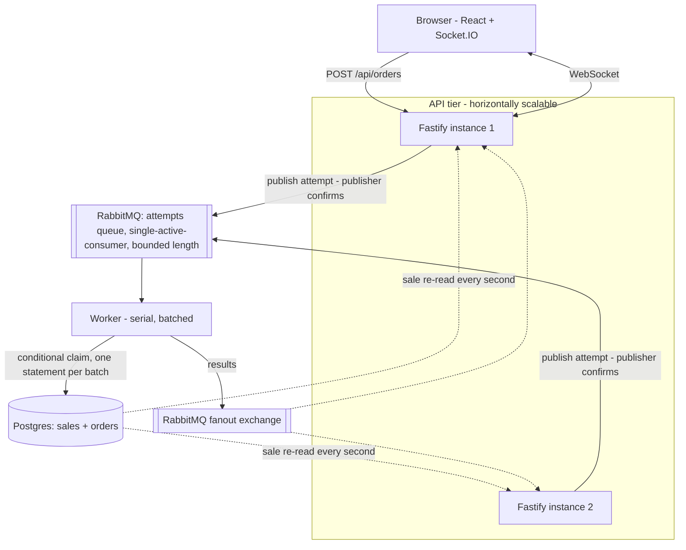

# Flash Sale — Requirement Analysis & Implementation Plan

Companion to [REQUIREMENT.md](./REQUIREMENT.md). This is the plan I intend to build against; the final `README.md` will be derived from the decisions recorded here.

## 1. What is actually being assessed

The brief is small enough to brute-force with a single Postgres row and a `SELECT ... FOR UPDATE`. That would pass the functional tests and fail the exercise. The grading criteria name *System Design*, *Correctness under load*, *Testing*, and *Pragmatism* — so the deliverable has to make three things visible:

1. **One serialization point, and it is in the right place.** Every purchase must funnel through a single ordered decision. The design question is not *whether* to serialize but *where*, and what that placement costs.
2. **A failure story.** What breaks when the component holding that decision dies, and whether the breakage is oversell (unacceptable — you sold stock you do not have) or undersell (recoverable).
3. **Tests that prove the invariant, not tests that exercise the happy path.** A stress test reporting "12k req/s, 0 errors" proves nothing. One that asserts `orders === stock` exactly, under 20× oversubscription, proves everything.

Everything below optimises for making those three legible.

## 2. Requirement analysis

### 2.1 Functional, restated as invariants

| # | Requirement | Invariant to enforce | Where enforced |
|---|---|---|---|
| 1 | Configurable sale window | No claim outside `[startAt, endAt)` | API fast-reject + worker |
| 2 | Single product, limited stock | `count(orders) <= totalStock`, always | Conditional claim statement (§4) |
| 3 | One item per user | `count(orders where user) <= 1` | `ON CONFLICT` in the claim + `UNIQUE (sale_id, user_id)` |
| 4 | API: status / purchase / check | — | Fastify HTTP + WebSocket |
| 5 | React frontend | — | Vite + React + Socket.IO client |
| 6 | System diagram | — | Mermaid in README |

Invariants 2 and 3 get **two independent enforcers**: the worker's in-memory state for speed, and database constraints as the durable backstop. If the worker is ever wrong, Postgres refuses the write and we get an alert instead of an oversold product.

### 2.2 Ambiguities, and the decisions I am taking

The brief leaves these open. Each is a defensible judgement call; the README will state the choice and the reason.

- **Is there authentication?** No. `userId` is a client-supplied string, exactly as the brief's frontend description implies ("enter a user identifier"). The one-per-user rule is therefore enforced *per identifier*, not per human. I will say so explicitly rather than pretend otherwise, and note that in production this key would come from a verified session.
- **Is the purchase synchronous?** No — and this is the central decision. `POST /api/orders` returns `202 Accepted` once the attempt is durably queued; the outcome arrives over a WebSocket. The brief sanctions this directly by asking for a separate "check if you secured an item" endpoint, which doubles as the reconnect path. §3 explains why the asynchrony buys more than it costs — and §15.2 is the stronger reason: the moment a payment step exists, a synchronous response is impossible anyway, because no HTTP request should be held open across a PSP round trip. Choosing async now is what keeps that door open.
- **Is "already purchased" an error?** No — it is a success. Because each user may hold at most one item, `userId` is a natural idempotency key: a retried attempt resolves to the *same* order. This matters because the first thing a panicking user does is double-click.
- **Is stock exposed?** Exact remaining stock is a poll magnet and leaks sale mechanics. The status endpoint returns a coarse `availability: "plenty" | "low" | "sold_out"`, not a live counter.
- **Reservation or sale?** A claim is final, not a held reservation. There is no payment step in the brief, so a TTL'd reservation that can expire adds a class of states ("expired, stock returned") the requirement never asks for. Out of scope — but it is the first thing that changes if payment arrives, and §15.2 works through what it would cost.

### 2.3 Non-functional targets

Concrete numbers, so the stress test has something to pass or fail:

- **Throughput:** ≥ 10k purchase attempts/sec sustained on a laptop-scale docker-compose.
- **Latency:** p99 < 100 ms from `POST` to the WebSocket result, measured end to end, for attempts that are not queued behind a burst.
- **Correctness:** zero oversell and zero double-grant at any load. Non-negotiable; this one gets asserted, not merely measured.
- **Load shedding:** when the queue saturates, the system rejects cleanly rather than growing unboundedly.

## 3. Architecture



*Revised in phase 8 to match what was built.* The first draft had the worker hold stock and the buyer set in memory, rebuilt from Postgres on promotion, and publish a sellout message. The counter-row decision (§16 q5) made all three unnecessary: the claim locks the sale row and reads stock under that lock, a buyer's existing order is found by one lookup per batch, and API instances learn of sellout from their once-a-second refresh. The worker holds no state, so a promoted worker has nothing to rebuild.

**The queue is the concurrency control.** A single active consumer processes attempts in order, so there is no race to arbitrate — correctness comes from the topology, not from clever locking. The worker checks and claims in one database transaction, which means there is no separately-granted outcome waiting to be persisted, and therefore **no outbox and no two-system divergence**.

**Component roles:**

- **API (Fastify + Socket.IO).** Rejects what it can for free (§6), publishes the rest to RabbitMQ with publisher confirms, and holds the user's WebSocket. Horizontally scalable; the only state it holds is its own socket map.
- **RabbitMQ.** Carries purchase *attempts* (requests, not decisions) on a durable, length-bounded **quorum** queue with `x-single-active-consumer`, replicated across a three-node cluster (§5.1), and carries results, sellout and presence back on a fanout exchange.
- **Worker.** The sole writer. Batches claims into single-statement transactions and publishes each outcome to the fanout after the commit. Holds no state of its own: stock is read under the claim's lock.
- **Postgres.** System of record and the durable enforcer of both invariants. Chosen over MongoDB on measurement, not habit: [`prototype/postgres-vs-mongo/`](./prototype/postgres-vs-mongo/) puts it 3–7× faster at equal fairness, and finds that MongoDB has no `FOR UPDATE SKIP LOCKED` equivalent — so it must trade arrival-order fairness for throughput, while Postgres gets both.

**Why the queue, and not a distributed cache making the decision:** the alternative I costed first was an atomic Redis Lua script granting stock synchronously, with a stream handing off to a persistence worker. It is faster (§13) but strictly worse on correctness: a grant lives in Redis before it reaches Postgres, so a crash in that window means a user was told "confirmed" and holds nothing. In the design below, a result is only ever published **after** the transaction commits — the system never tells a user something false. The spike that evaluated it is kept at [`prototype/redis-grant/`](./prototype/redis-grant/).

**Why not claim directly in the API request:** because contention on the stock row is measurably catastrophic. With 50 connections competing for the same row (§4), throughput rose 7% over a single connection while mean latency rose 46×. Serializing in the queue converts that convoy into an ordered stream, and lets the worker batch.

| Rejected alternative | Why |
|---|---|
| `UPDATE ... WHERE remaining > 0` from N API instances | Lock convoy. Measured: 899 tps at 55.6 ms mean vs 835 tps at 1.2 ms single-connection. |
| Application-level mutex / in-process counter | Breaks with more than one API instance, which is exactly the scalability the brief asks for. |
| Optimistic concurrency with retries | Under heavy contention almost every attempt retries; wasted work grows with load, which is backwards. |
| Redis Lua grant + stream to Postgres | Faster, but introduces a window where a confirmed user has no durable order. See `prototype/redis-grant/`. |

## 4. The critical path: one conditional claim

The worker's claim must write the order **only if** it actually took a unit. Doing this as a separate `UPDATE` then `INSERT` invites the bug where the update matches no rows and the insert happens anyway. One statement removes the possibility:

```sql
WITH claimed AS (
  UPDATE sales SET remaining = remaining - 1
  WHERE id = $1 AND remaining > 0
  RETURNING id
)
INSERT INTO orders (sale_id, user_id)
SELECT $1, $2 FROM claimed
ON CONFLICT (sale_id, user_id) DO NOTHING
RETURNING id;
```

An empty result means "no unit taken", for either reason — sold out, or this user already holds one. The worker distinguishes the two with one lookup of existing orders per batch (`findExistingOrders`).

This single-claim form is correct but slow (§4.3): it pays an fsync per purchase. The worker ships the batched form below.

### 4.1 The batch claim

The batch takes an array of user ids **in arrival order** and claims as many as stock allows:

```sql
WITH input AS (
  SELECT user_id, ord
  FROM unnest($2::text[]) WITH ORDINALITY AS t(user_id, ord)
),
locked AS (
  SELECT remaining FROM sales WHERE id = $1 FOR UPDATE
),
candidate AS (
  SELECT i.user_id FROM input i, locked l WHERE i.ord <= l.remaining
),
ins AS (
  INSERT INTO orders (sale_id, user_id)
  SELECT $1, user_id FROM candidate
  ON CONFLICT (sale_id, user_id) DO NOTHING
  RETURNING user_id
)
UPDATE sales SET remaining = remaining - (SELECT count(*) FROM ins)
WHERE id = $1
RETURNING remaining, (SELECT array_agg(user_id) FROM ins) AS winners;
```

Three properties, each load-bearing and each verified in §4.4:

1. **It decrements by rows *actually inserted*, not by batch size.** This is what makes a redelivered batch a no-op: on redelivery every user already has an order, `ins` returns zero rows, and the decrement is zero. The obvious alternative — `remaining - array_length($2)` — would double-decrement on every redelivery and silently destroy stock. Since RabbitMQ delivery is at-least-once, this is not a hypothetical.
2. **`ord <= remaining` preserves arrival order.** When a batch straddles sellout, the earliest arrivals win. The brief asks for fairness; this is where it is implemented.
3. **Duplicates inside one batch cost one unit, not several.** `ON CONFLICT DO NOTHING` tolerates the same user appearing twice in a single statement, and because the decrement follows the insert count, stock stays correct.

`FOR UPDATE` is defence in depth. With one active consumer there is no concurrency to guard against, but it means the statement is still correct if a second worker is ever running — during a botched failover, say.

### 4.2 How batching works in the worker

RabbitMQ has no "give me 100 messages" call; `amqplib` pushes one at a time. Batching is therefore something the worker does, with a size-or-time flush:

```ts
const BATCH_MAX = 100;
const FLUSH_MS  = 5;

await channel.prefetch(BATCH_MAX * 2);   // keep the next batch arriving while this one commits

let pending: Message[] = [];
let timer: NodeJS.Timeout | null = null;
let flushing: Promise<void> = Promise.resolve();

channel.consume(queue, (msg) => {
  pending.push(msg);
  if (pending.length >= BATCH_MAX) scheduleFlush();
  else timer ??= setTimeout(scheduleFlush, FLUSH_MS);
});

// Serialised: batches must never overlap, see the gotchas below.
function scheduleFlush() {
  flushing = flushing.then(flush);
}

async function flush() {
  if (timer) { clearTimeout(timer); timer = null; }
  const batch = pending;
  pending = [];
  if (batch.length === 0) return;

  // In-memory pre-filter: never ask the database about a user we know holds
  // an order, and never ask at all once we know stock is gone.
  const { candidates, rejected } = prefilter(batch, state);

  const winners = candidates.length ? await claimBatch(saleId, candidates) : [];

  channel.ack(batch[batch.length - 1], /* allUpTo */ true);   // AFTER commit
  publishResults(batch, winners, rejected);                   // one fanout message
}
```

Four things that are easy to get wrong:

- **Flushes must not overlap.** `channel.ack(msg, true)` acks every delivery up to that tag. If two batches are in flight at once, acking the later one also acks the earlier one — whose transaction may not have committed. Chaining flushes through a single promise costs one line and removes the whole class of bug.
- **Ack strictly after commit.** This is the entire crash-safety story. Commit-then-die leaves the batch unacked, it gets redelivered, and §4.1 makes the replay a no-op. Ack-then-commit would lose purchases.
- **Prefetch must exceed the batch size.** Prefetch caps unacked deliveries; if it equals `BATCH_MAX` the broker stops sending the moment a batch is assembled, and the worker idles through the commit instead of accumulating the next one. Twice the batch size keeps the pipeline full.
- **Publish results as one message, not one per attempt.** A batch of 100 produces one fanout message carrying 100 outcomes; each API instance filters it against its own socket map. Per-attempt messages would put the fan-out cost back into the hot path.

**The flush trigger makes this self-tuning**, which is the part worth noting in the README. Under light load the timer fires first, so batches are small and latency is ~5 ms. Under a burst the size trigger fires first, so batches are full and throughput is maximal. Batches grow exactly when they need to, and no one has to choose between latency and throughput up front.

### 4.3 Measurements

A spike at [`prototype/postgres-claim/`](./prototype/postgres-claim/) runs all of this against a real Postgres 18.6 under `pgbench`, default config (`synchronous_commit=on`). Measured, not estimated:

| Scenario | Result |
|---|---|
| 20 000 attempts (50 connections) against stock of 1000 | **exactly 1000 orders, 1000 distinct users, `remaining` = 0** — no oversell |
| Serial worker, 1 claim per transaction | 835 claims/s, 1.2 ms mean |
| Serial worker, 100 claims, multi-statement transaction | ~23 650 claims/s, 4.2 ms per batch |
| Serial worker, 100 claims, **single-statement batch (§4.1)** | **~37 000–41 500 claims/s**, 2.4–2.7 ms per batch |
| 50 connections contending on the stock row | 899 claims/s, **55.6 ms mean** |
| Post-sellout rejections | ~17k/s even when they reach Postgres |

Four conclusions drive the rest of the design:

1. **Batching is not an optimisation, it is the design.** 835/s would miss the 10k/s target by an order of magnitude; the batched form clears it ~4×. The cost is the fsync per commit, so amortising the commit is where all the throughput lives.
2. **Round trips cost as much as the work.** Collapsing `BEGIN / UPDATE / INSERT / COMMIT` into one statement was worth ~1.6× on its own — 23 650 → ~41 500 claims/s — for identical database work. At this granularity the network dominates, which is why §4.1 is one statement and not a transaction block.
3. **Contention is real and the queue is what avoids it.** 50× the concurrency bought 7% more throughput and 46× the latency. That is the lock convoy, measured, and it is the strongest argument for serializing upstream.
4. **The rejection path is cheap even at its worst.** Post-sellout rejections sustained ~17k/s *while still hitting Postgres*. Since §6 rejects them in memory instead, the real ceiling is far higher — and the expensive path is bounded by `totalStock`, not by traffic.

### 4.4 Verified batch behaviour

| Case | Expected | Result |
|---|---|---|
| Batch of 100, stock 1000 | 100 granted, 900 remaining | ✅ |
| Batch of 100, stock 5 | 5 granted, 0 remaining | ✅ |
| Same batch, by arrival order | first five win | ✅ `b001…b005` |
| **Redelivery of a committed batch** | 0 granted, stock unchanged, no new orders | ✅ idempotent |
| Same user three times in one batch | 1 granted, 1 unit consumed | ✅ |
| Batch against stock 0 | 0 granted | ✅ |
| Two batches straddling sellout | `orders = total_stock - remaining` | ✅ 50 orders, 0 remaining |

## 5. Durability and failure modes

| Failure | Behaviour | Severity |
|---|---|---|
| API instance dies | Sockets drop. Client reconnects to another instance and re-syncs via `GET /api/orders?userId=`. An already-queued attempt still gets processed; the result is waiting. | None |
| Worker dies mid-batch | Uncommitted transaction rolls back; messages were never acked, so RabbitMQ redelivers them to the newly promoted consumer. | None |
| Worker dies after commit, before ack | Redelivery re-runs the claim; `ON CONFLICT DO NOTHING` makes it a no-op and the result is re-published. Idempotent. | None |
| Postgres down | Worker stops acking; the queue backs up to its bound, then the API sheds load with `503`. No incorrect answers are given. | Degraded, self-healing |
| One broker node dies | Quorum queue elects a new leader from the surviving replicas; publishes fail for the few seconds that takes, then resume. Committed messages survive, because a confirm means a majority already has them. | Brief, self-healing |
| Broker cluster loses its majority | Queues become unavailable — quorum queues choose consistency over availability. No attempts accepted; API returns `503`. | Outage, correct |
| Result message lost | User's socket shows nothing; the reconnect/poll path resolves it from Postgres. | Cosmetic |

**The property worth stating plainly: a user is never told "confirmed" unless the row is committed.** Results are published after the transaction, so there is no window in which the system's answer and its durable state disagree. That is the main thing this design buys over the Redis alternative, and it is why depending on RabbitMQ is an acceptable trade — an outage is honest, whereas a false confirmation is not.

Required for the above to hold:
- **Publisher confirms** on the API side. Without them a "published" attempt can vanish and the user waits forever for a result that will never come.
- **Persistent messages** on a durable queue.
- **Bounded queue** via `x-max-length` with `overflow: reject-publish`, so saturation becomes a clean `503` rather than unbounded memory growth and unbounded latency.

### 5.1 Broker topology

A single broker makes RabbitMQ a single point of failure for the whole sale, which is the weakest part of the design as otherwise specified. **The attempts queue is a quorum queue on an odd-sized cluster — three nodes, spread across availability zones.** Quorum queues are Raft-replicated with majority consensus, so a three-node cluster tolerates losing one node and a five-node cluster tolerates two. They also replace classic mirrored queues, which are gone from current RabbitMQ, so this is the supported path rather than an upgrade.

Two things this changes beyond uptime:

- **Publisher confirms get stronger.** On a single node a confirm means "on one broker's disk". On a quorum queue it means "on a majority of replicas", so the confirm the API waits for before returning `202` now genuinely survives a node loss. The two mechanisms reinforce each other; neither is sufficient alone.
- **`x-single-active-consumer` still applies**, so the serialization the whole design rests on is unaffected by replication.

Not every queue should be quorum. The per-instance queues bound to the results fanout (§8) are exclusive and auto-delete — they are meant to die with their API instance, and losing one costs nothing because the client re-syncs via `GET /api/orders?userId=`. Replicating them would pay a consensus cost for data with no value past the second it was produced.

**What this does not fix**, and the README should say so rather than imply a cluster is a cure:

- **Failover is not instantaneous.** Leader election takes seconds, during which publishes fail. The API still needs the `503` path; a cluster shortens the outage, it does not remove the need to handle one.
- **A network partition still fails the minority side.** Quorum queues are CP: nodes in the minority cannot serve the queue. That is the correct choice here — availability bought by accepting writes into a partition that may be rolled back is exactly the false-confirmation failure this design exists to avoid.
- **Consensus costs throughput.** Every publish is replicated and acknowledged by a majority, so a quorum queue is slower per message than a single-node classic queue. The bounded queue above matters more, not less, once this cost is real.

For the exercise itself, `docker-compose.yml` runs a single broker so the reviewer's first command stays fast; the cluster overlay considered here was not built. The production topology is a documented decision, not an undemonstrated claim — which is the distinction §12 draws for everything else that is simplified for local running.

## 6. Early rejection: what never reaches the queue

Most flash-sale traffic is doomed, and the cheapest request is the one that never gets published. Three filters at the API layer, in increasing cost:

1. **Window check — free.** `startAt`/`endAt` are static config, so the entire pre-sale rush and everything after the end is rejected in process with zero I/O.
2. **Sellout flag — one message, then free.** When the worker takes the last unit it publishes `SOLD_OUT` once to the fanout; every API instance sets a local boolean and rejects in memory from then on. This is safe because **sellout is monotonic**: it only ever flips one way, and only the sole writer can flip it. A stale flag can only ever be wrong in the harmless direction (enqueueing a doomed attempt that the worker rejects), never in the direction that wrongly rejects a buyer.

   *Not built (noted in phase 8).* Filter 3's one-second refresh alone proved enough: in the stress run, everything after sellout except the attempts arriving within that second was refused from cache — 208 000 of 233 000. The message would shorten that window from a second to milliseconds; the reasoning below about monotonicity applies to the refreshed value just the same.

   This monotonicity is an assumption, not a law, and it holds only while a claim is final. Anything that can return a unit to a live sale — a payment step with expiring reservations (§15.2), or a manual restock — makes the flag a cache rather than a terminal state, and the reasoning above stops being valid. Filter 3 below is what keeps it honest, which is why it is not optional.
3. **Periodic refresh — one row per instance per second.** Each instance re-reads `sales.remaining` on a timer, covering instances that booted late or missed the fanout message. This is why `remaining` is a denormalized column rather than a `count(*)`: it keeps the refresh a single primary-key read.

   Note that this filter consumes `remaining` almost entirely as a *boolean*. That is what makes the pool model of §16 q5 a drop-in replacement despite having no counter: `EXISTS` against its partial index answers the same question in one probe.

Deliberately **not** filtered at the API layer: "already purchased". It needs a per-user lookup, the frontend already disables the button while a request is in flight, and the worker finds duplicates with one lookup per batch for almost nothing. Paying a database round trip per request to catch a rare case would be a bad trade.

Rate limiting still applies on top: a per-IP and per-user token bucket, rejecting with `429`. Not in the brief, but an endpoint this attractive without a limiter is a conspicuous omission.

The limiter is `@fastify/rate-limit`, whose default store is **in process, not shared**, so the effective limit across N instances is N times the configured one. That is a real weakening and it is stated rather than hidden: a shared counter would need a store on the path of every request, and this design deliberately has none. The limiter exists to blunt a single abusive client; the bounded queue (§5) and the claim (§4) are what actually protect the sale, and neither depends on it.

## 7. API surface

| Method | Path | Returns |
|---|---|---|
| `GET` | `/api/sale` | `{ status, availability, startAt, endAt, serverTime, viewers }` |
| `POST` | `/api/orders` | create: `202 { status: "queued", attemptId }` + `Location: /api/orders?userId=` · `409 { status: sold_out\|not_started\|ended }` · `429` · `503` |
| `GET` | `/api/orders?userId=` | index, filtered: `200 [{ orderId, purchasedAt }]` — zero or one entries · `400` without the filter — reconnect source of truth |
| `GET` | `/healthz` `/readyz` `/metrics` | liveness, readiness, Prometheus |

Orders are a REST resource with `index` and `create`. `new`/`edit` are server-rendered forms an SPA does not need; an order is immutable once claimed, so no `update`/`destroy` (cancellation arrives with payment, §15.2). A reconnecting client knows its user but not its order id, so it asks for the user's orders — a filtered `index`, not a `show` keyed by something other than the order's id. The filter is required: unfiltered, `index` would expose every buyer while there is no authentication. Nothing needs `show` yet; it would be `GET /api/orders/:orderId`. `create` answers `202 Accepted` rather than `201 Created` because the order is decided asynchronously, and its `Location` is the filtered index the order will appear in.

WebSocket events pushed to the client:

| Event | Payload |
|---|---|
| `purchase:result` | `{ attemptId, status: confirmed\|already_purchased\|sold_out, orderId? }` |
| `sale:status` | `{ status, availability }` — broadcast on change |
| `sale:viewers` | `{ count }` — aggregated presence, every few seconds |

`GET /api/sale` is cached in process and refreshed on the same 1 s timer as the sellout check, so the highest-volume endpoint costs no I/O per request. `serverTime` is returned so the frontend countdown does not trust the client clock.

Every timestamp in these payloads — `startAt`, `endAt`, `serverTime`, `purchasedAt` — is ISO 8601 UTC with an explicit `Z` suffix, per §9.1. The API never emits a local time and never accepts one.

## 8. WebSocket transport and cross-instance delivery

**Library: Socket.IO**, for reconnection, heartbeats and acknowledgements — all of which matter here because a socket dropping mid-purchase is routine, and hand-rolling reconnect on raw `ws` is a meaningful chunk of work for no credit.

**But not its Redis adapter.** The usual way to broadcast across instances is `@socket.io/redis-adapter`, which would reintroduce Redis purely as a message bus — undoing the simplification this design just bought. RabbitMQ is already present and does the same job:

- **Results target exactly one user.** Each API instance consumes the fanout, looks up its own local `Map<userId, socket>`, and delivers or discards. No cross-instance room broadcast is needed at all.
- **Presence and status are broadcasts**, so each instance simply emits locally to its own connections on receiving the fanout message.

**Presence is aggregated, never exact.** Exact per-connection accounting broadcast to everyone is O(N²). Instead each instance publishes its own connection count to the fanout every few seconds; every instance keeps a `{instanceId: count, seenAt}` map, expires stale entries, and sums locally. O(N), no central aggregator, and the number is decorative so approximation is free. This is the "X other people are looking at this" feature — not required by the brief, but it is what a real flash sale shows, and the WebSocket is already there.

## 9. Data model

```sql
CREATE TABLE sales (
  id          TEXT PRIMARY KEY,
  total_stock INTEGER NOT NULL CHECK (total_stock >= 0),
  remaining   INTEGER NOT NULL CHECK (remaining >= 0),   -- denormalized; keeps §6 a PK read
  start_at    TIMESTAMPTZ NOT NULL,
  end_at      TIMESTAMPTZ NOT NULL,
  CHECK (end_at > start_at)
);

CREATE TABLE orders (
  id         UUID PRIMARY KEY DEFAULT gen_random_uuid(),
  sale_id    TEXT NOT NULL REFERENCES sales(id),
  user_id    TEXT NOT NULL,
  created_at TIMESTAMPTZ NOT NULL DEFAULT now(),
  UNIQUE (sale_id, user_id)          -- the durable one-per-user backstop
);
CREATE INDEX ON orders (sale_id);
```

`CHECK (remaining >= 0)` is the durable anti-oversell backstop: even a logic bug cannot drive stock negative, because Postgres will abort the transaction. Combined with the `UNIQUE` constraint, both headline invariants are enforced by the database independently of any application code.

The worker rebuilds its in-memory state on startup or promotion with two queries — `SELECT remaining FROM sales` and `SELECT user_id FROM orders WHERE sale_id = $1`. Both are bounded by `totalStock`, so promotion is fast.

### 9.1 Time handling

**Every instant is UTC from the database to the API boundary, and is localized only in the browser.** A sale that opens at a wall-clock time in one country and is bought from another gets this wrong in ways that are invisible until someone misses the sale, so the rule is worth stating as a constraint rather than a convention.

**In the database.** Every column is `TIMESTAMPTZ`, never `TIMESTAMP`. This matters more than it looks: `TIMESTAMPTZ` does not store a timezone at all — it stores a UTC instant and converts on the way in and out using the session's `TimeZone`. `TIMESTAMP` stores a wall-clock reading with no instant attached, so two of them cannot be meaningfully compared across zones, and `node-postgres` parses one into a `Date` using *the Node process's* local zone, silently shifting the value. Using `TIMESTAMPTZ` everywhere makes UTC storage automatic.

What is not automatic is the session zone, so it gets pinned in three places: `timezone = 'UTC'` in the server config, `TZ=UTC` in every container, and `options: '-c timezone=UTC'` on the connection pool. The last one is the one that actually protects us, since it survives being pointed at someone else's database.

Two consequences of `now()` worth knowing:

- It returns transaction start time, not wall clock. In a batched claim (§4.1) **all 100 rows share one `created_at`**, so `created_at` cannot break ties within a batch. Ordering within a batch comes from `id`, which is why §4.1 allocates by `ord` rather than by timestamp.
- `clock_timestamp()` is the one that advances inside a transaction, and is wrong for `created_at` precisely because it would make rows in one commit disagree.

**At the API boundary.** Every timestamp crosses as ISO 8601 with an explicit `Z` — `2026-11-20T10:00:00.000Z`. `JSON.stringify` already calls `toISOString()` on a `Date`, so the default is correct provided nothing hand-formats on the way out. No epoch integers (ambiguous units), no bare local strings, no offsets other than `Z`. Sale configuration is accepted the same way: an absolute instant, never a wall-clock reading plus an implied zone. Configuring in UTC also sidesteps the spring-forward case where the configured local time does not exist.

**In the browser.** Parse to a `Date` and render with `Intl.DateTimeFormat`, using the zone and locale the browser resolves. Never assemble a string from `getHours()` and friends — that skips locale conventions and the 12/24-hour preference. Include `timeZoneName: 'short'`, because a user needs to know *which* zone the sale opens in, not just a number.

**Clock skew and timezone are different problems, and only one of them is ours.** A browser with the wrong *timezone* still has a correct `Date.now()`, because the OS holds UTC underneath — so a timezone misconfiguration only ever corrupts display. A browser with a wrong *clock* has a wrong instant, which would corrupt a countdown. That is what `serverTime` is for (§10): take `offset = serverTime - Date.now()` on each poll and drive the countdown from `Date.now() + offset`, so the countdown stays right even on a device that is minutes out. The window check itself is never client-side, so a skewed clock can only ever mislead the user, never admit them early.

## 10. Frontend

Deliberately small — the brief asks for a demonstration, not a storefront. Vite + React + TypeScript, one page:

- Sale status and countdown driven off `serverTime`, with start and end rendered in the viewer's own timezone and locale via `Intl.DateTimeFormat` and labelled with the zone (§9.1).
- A `userId` input, persisted to `localStorage` so a refresh does not lose your identity.
- A "Buy Now" button, disabled outside the active window and while a request is in flight.
- An explicit **queued** state between `202` and the WebSocket result — this is the honest representation of what the system is doing, and it is where a real flash sale shows a spinner.
- Terminal states: *confirmed* (with order id), *already purchased*, *sold out*, *not started*, *ended*, *try again* (on `503`).
- Live viewer count from `sale:viewers`.
- On mount and on every reconnect, it calls `GET /api/orders?userId=`, so a dropped socket never loses a result.

## 11. Testing strategy

**Unit (Vitest).** Window/status derivation, the monotonic sellout flag state machine, presence aggregation and stale-instance expiry, result-to-UI-state mapping. Fast, no I/O.

**The whole suite runs under a deliberately non-UTC `TZ`** — something with an awkward offset and DST, say `TZ=America/St_Johns` or `Pacific/Chatham`. A test suite that only passes in UTC cannot catch code that accidentally depends on the process's local zone, which is the exact bug §9.1 exists to prevent. CI runs it both ways: once in UTC, once shifted.

**Integration (Vitest against real RabbitMQ and Postgres via docker-compose).** The claim statement, worker batching, consumer failover, and — importantly — **redelivery idempotency**: ack a message only after commit, kill the worker between the two, and assert the redelivered message produces no second order.

**The two decisive tests**, run through the full stack rather than against the database alone:

1. *No oversell.* Stock = 1000, 20 000 attempts from 20 000 distinct users. Assert exactly 1000 `confirmed`, 19 000 rejected, **and** exactly 1000 rows in `orders` once the queue drains. Both halves are required: [`prototype/postgres-pool/`](./prototype/postgres-pool/) contains a claim that oversells 9.5× while leaving final table state immaculate, so a test asserting only on rows would pass it. The count of successes *returned to clients* is the assertion that catches a lost update.
2. *No double-grant.* 1000 concurrent attempts from **one** user. Assert exactly one order and `remaining` decremented by exactly one.

Both already hold at the SQL layer — `prototype/postgres-claim/` demonstrates 20 000 attempts producing exactly 1000 orders — so the integration versions are testing the queue and worker wiring, not the claim itself.

**End-to-end (Playwright, against the full docker-compose stack).** The third layer, and the only one that can see what this design is actually unusual for: a purchase that resolves over a WebSocket rather than in the HTTP response. Integration tests prove the queue and the claim are correct; they cannot prove the user ever finds out.

What belongs here, in rough order of value:

| Spec | What it proves |
|---|---|
| `purchase` | The async flow end to end: click → `202` → **queued** state visible → `purchase:result` arrives → confirmed with an order id. The intermediate state is the point; it is the one thing a synchronous design would not have. |
| `reconnect` | **The critical resilience path.** Drop the socket mid-purchase with `context.setOffline(true)`, restore it, and assert the client re-syncs through `GET /api/orders?userId=` and lands on the correct terminal state. §5 claims a dropped socket is cosmetic — this is what makes that a verified claim rather than an assertion. |
| `concurrency` | Several browser contexts race for the last units. One wins, the others see *sold out*. Tests the UI's handling of losing, not the invariant. |
| `presence` | Open three contexts, assert the viewer count converges to three; close one, assert it falls. The §8 fanout aggregation has no other honest test. |
| `lifecycle` | *upcoming → active → ended* observed live, without a reload. |
| `time` | Launch contexts with `timezoneId: 'Asia/Tokyo'` and `'America/St_Johns'` and assert the same instant renders correctly in each, labelled with its zone. Then use Playwright's clock API to skew the browser clock and assert the countdown stays correct — which is exactly the §9.1 claim that skew corrupts a countdown while timezone only corrupts display. |
| `rejection` | *not started*, *ended*, *already purchased*, and a `503` under load shedding each produce the right message rather than a stack trace. |
| `double-click` | The button disables in flight; two rapid clicks produce exactly one `POST`. |

Three rules keep this layer from becoming a liability:

- **It tests the experience, never the invariant.** The oversell proof stays in integration and stress, where 20 000 attempts cost nothing. Twenty thousand browsers is not a test, it is a denial of service against your own CI. A race between five contexts for two units is legitimate E2E; a race between twenty thousand is not.
- **No fixed sleeps, ever.** WebSocket arrival time is nondeterministic, so every assertion goes through Playwright's retrying `expect`. A flaky E2E suite is worse than none, because it trains people to re-run red builds.
- **Each spec seeds its own sale.** A test-only reset endpoint, registered only when the API runs as `APP_ENV=e2e` and so never in a deployed environment, gives each spec a fresh sale with known stock and window. Tests that share mutable state across a queue and a worker will interfere in ways that look like real bugs.

Playwright can also observe the socket directly — `page.on('websocket', ws => ws.on('framereceived', …))` — which is worth wiring into the fixtures as a diagnostic. When a UI assertion fails it immediately separates "the server never sent it" from "the client ignored it", and those have very different fixes. Socket.IO frames carry Engine.IO encoding, so the UI state stays the primary assertion and frames are for triage.

**As built (phase 6).** All eight specs exist and pass, 65 of 65 across five repetitions. Decisions taken while building them:

- **One sale, reset per spec, run serially.** The API serves a single configured sale, so "each spec seeds its own sale" means each spec resets it through the test endpoint, and specs cannot run in parallel. The reset refreshes the API's sale cache before answering; otherwise a spec sees the previous sale for up to a second.
- **The queued state is held, not raced.** In real timing the result follows the `202` by milliseconds, so `purchase` holds the result frame at the socket (`page.routeWebSocket`) until the queued state has been asserted, and `reconnect` drops it on the first connection.
- **`503` and `429` are substituted at the network.** The spec tests the UI's handling; producing a real `503` means saturating the queue, which belongs to stress (phase 7).
- **The E2E stack runs the built app**, not the Vite dev server: the API serves the SPA on one origin, as it ships.

The layer earned its place on its first run, against code that had passed every unit test and a browser walkthrough:

- **`reconnect` failed.** The page looked up the user's order on arrival but not on reconnect, so a result lost with the socket left it on *queued* for an order that existed. It now re-syncs after every automatic reconnect — making §5's "a dropped socket is cosmetic" true rather than asserted.
- **Every upcoming sale crashed the page.** The local-time label combined `dateStyle` with `timeZoneName`, which the `Intl` constructor rejects, so rendering threw and the page went blank. Every earlier check had used an open sale.
- **A refresh mid-purchase forgot it.** Found by watching it rather than by a spec: with the worker held back, a reloaded page offered Buy again while its attempt sat in the queue, and never explained a later rejection, because the queue holds requests, not anything a page can look up. The page now remembers its pending attempt in `localStorage` (shared by the user's tabs, which already all receive their results), restores it on reload, and lets it go after two minutes. A restored attempt whose result was missed — the page was closed when it arrived — is settled by a fresh order lookup plus the sale: no order once the sale has sold out or ended means it failed. That derivation is confined to restored attempts, because for a live one the "sold out" push can arrive just before the result of the purchase that took the last unit. The `refresh` spec covers it.

**Stress (k6).** Ramp to high concurrency over ~60 s with thresholds encoded as pass/fail, driving HTTP for attempts and holding WebSocket connections for results, so the measured latency is genuinely end-to-end rather than time-to-`202`. A teardown asserts the same invariants at realistic load. Results and their interpretation go into the README.

**Load shedding is a test case, not an afterthought.** Drive past the queue bound and assert the API returns `503` cleanly, memory stays flat, and no attempt is silently dropped.

**As built (phase 7).** `pnpm stress sale|shedding|capacity`, k6 from Docker against its own `APP_ENV=stress` stack with two API instances — a buyer's socket on one, their `POST` on the other, so results cross the fanout. The invariants are checked in Postgres afterwards. Measured on one laptop running everything: end-to-end p99 34 ms; 10 000 attempts/s held for 20 s against 20 000 units, 11.7× oversubscribed, with exactly 20 000 orders to distinct buyers; at the bound, every overflow shed with `503` and every accepted attempt an order. The rush is held at the API — 208 000 of 233 000 attempts refused from cache after sellout — while the queue path alone sustains ~8 600/s here, degrading by shedding rather than by latency. The README has the table and the reading of it.

Two thresholds were loosened after measuring, both stated where they are set: the queue bound is not exact with concurrent publishers (50 over 50 000), and a rush counts as held with under 1% of planned arrivals dropped by k6, since a shared laptop always drops a handful.

The first run found a real defect: the worker drained at ~4 000 claims/s against ~35 000/s for the claim alone, because Nagle's algorithm held its ack behind its result publish for ~20 ms every batch. Every broker connection now goes through `connectBroker`, with `noDelay`.

## 12. Repo layout and tooling

```
apps/
  api/        Fastify + Socket.IO, early rejection, publisher confirms
  worker/     single-active consumer, batched claims, result publishing
  web/        Vite + React frontend
packages/
  core/       domain types, status logic, config schema, shared message contracts
tests/
  integration/
  e2e/        Playwright specs + seeded-sale fixtures
  stress/     k6 scenarios
docs/
  REQUIREMENT.md  PLAN.md  prototype/
docker-compose.yml   README.md
```

pnpm workspaces. Fastify over Express for throughput and schema-based validation; `socket.io`; `amqplib` for RabbitMQ; `pg` with plain SQL rather than an ORM, since the claim is a hand-written CTE an ORM would only obscure; `zod` for config; `pino` for logging; `prom-client` for metrics; `@playwright/test` for E2E, driven by its `webServer` config so a single command brings the stack up and tears it down. ESLint flat config with `typescript-eslint` for correctness, Prettier for formatting and nothing else, `tsc --noEmit` under `strict`, `pnpm audit --audit-level=high`, and a licence allowlist check — all five gating CI rather than advisory, per [`CLAUDE.md`](../CLAUDE.md). Every runtime dependency named above is MIT or Apache-2.0, so the allowlist costs nothing to satisfy; it exists to catch what arrives transitively. One `docker compose up` brings up RabbitMQ, Postgres, API, worker and frontend, with `TZ=UTC` set on every service and the Postgres connection pinned to UTC per §9.1.

### 12.1 Serving the frontend — decided in phase 5, revised on review: the API serves it

`vite build` produces `apps/web/dist` and something has to serve it. The first attempt added an nginx service that served the SPA and reverse-proxied `/api` and `/socket.io` to the API. Review killed it, correctly, and the reasons generalise beyond this repo.

**Decision: the API serves the built SPA from `WEB_ROOT`, and routing to it is left to whatever is already in front.** One image, one process, one origin.

The nginx version embedded `proxy_pass http://api:3000` in an image. That is a *deployment topology* compiled into a build artefact, and it fails in every environment that is not the Compose file it was written for:

- **Outside Compose** — API and worker against a Postgres and RabbitMQ already on the host — the upstream name does not resolve, so the image is useless exactly when someone wants to run the app the simplest way.
- **Under Kubernetes** the proxying is redundant. An Ingress or an HTTPRoute already expresses "`/api` to this Service, `/` to that one", declaratively, in the chart. Shipping nginx too means two layers of routing, a second Deployment to run and scale, an extra hop on every request, and path rules that can only be changed by rebuilding an image. The upstream would also have to be templated per release, since the Service is `{{ .Release.Name }}-api`.

Serving the SPA from the API costs little. The assets are hashed and immutable, so each client fetches them once; and for a flash sale they are fetched while the countdown runs, not at `T=0` when the buy spike lands. The two are not contemporaneous, which is what the "don't put static files on the hot path" instinct is really about.

What remains true from the original argument is that assets should not be served from an origin at scale — but the answer to that is a CDN, not a second container. `WEB_ROOT` is therefore optional: leave it unset and the process is a pure API, with `/` routed to a bucket or CDN by the gateway. The same image covers both, and nothing about the application changes.

This is not `@fastify/vite`, which was also considered and rejected. That plugin couples Vite into the server for SSR and dev middleware; what is needed here is `@fastify/static` pointed at a directory, in production only. Development keeps the Vite dev server and its proxy, which already worked.

Two details the fallback must get right, both quiet when wrong:

- The static plugin is registered with `wildcard: false` and the SPA fallback lives in `setNotFoundHandler`. A wildcard route would answer unknown `/api` paths with the HTML shell, so a mistyped endpoint returns `200` and the client fails later, parsing HTML as JSON.
- Only navigations get the shell — `GET`/`HEAD` with `Accept: text/html`, outside the server's own prefixes. Everything else keeps the API's JSON `404`.

#### Trusting `X-Forwarded-For`

Removing nginx exposed a bug it had been hiding. The nginx config set `X-Forwarded-For` and a comment claimed this kept the per-IP rate limiter (§6) from collapsing into one bucket. It did not: Fastify's `trustProxy` defaults to `false`, so `request.ip` stayed the socket peer — nginx — and *every* request shared one bucket. Setting the header without trusting it does nothing. Measured: with `trustProxy` off, three requests from three forwarded addresses against `max: 2` return `200, 200, 429`; with it on, `200, 200, 200`.

So trust is now explicit, in `TRUST_PROXY`, and defaults to off:

- **off** — `request.ip` is the socket peer. Correct when the process is reachable directly, as it is under Compose.
- **a list of addresses or CIDRs** — the safe production setting behind a gateway.
- **`true`** — trusts the whole chain, which means the client chooses its own `request.ip` and can mint a fresh rate-limit bucket per request. Only acceptable where nothing but the gateway can reach the process *and* the gateway overwrites the header rather than appending to it.
- **a hop count is rejected at boot.** Fastify maps a numeric `trustProxy` to a function that trusts nothing, deliberately, because a hop count cannot validate the immediate peer. Accepting one would read as configured while trusting nobody, so the config refuses it with a message saying what to use instead.

#### What a Helm chart would look like

Nothing here needs to change for it. Two Deployments, `api` and `worker`, from the two images; a Service for `api`; an HTTPRoute (or Ingress) sending `/` to it. `TRUST_PROXY` is set to the gateway's CIDR, which is what makes per-IP limiting work behind it. Moving the SPA to a CDN later means unsetting `WEB_ROOT` and adding a route — no rebuild, no code change.

The remaining caveats are unchanged and documented elsewhere: rate limits are per instance (§6), so N replicas allow N times the configured limit, and presence is eventually consistent across instances (§8).

## 13. Implementation phases

Ordered so the risky part is proven first. Estimates are for a focused build.

| # | Phase | Output | Est. |
|---|---|---|---|
| 0 | Scaffold | pnpm workspaces, strict TS, ESLint + Prettier, `pnpm audit` gate, docker-compose, CI | 1–2 h |
| 1 | **Claim core** | Schema, migrations, claim statement, worker batching + both invariant tests — *statement already drafted and verified, §4* | 2 h |
| 2 | Queue wiring | amqplib, publisher confirms, quorum queue declaration, single-active-consumer, bounded queue, redelivery idempotency tests | 2–3 h |
| 3 | API | Fastify routes, three-tier early rejection, rate limiting, status cache | 2–3 h |
| 4 | WebSocket | Socket.IO, fanout consumption, local socket map, presence aggregation | 2–3 h |
| 5 | Frontend | React page, queued state, terminal states, viewer count, **and how it is served** (§12.1) | 3–4 h |
| 6 | **E2E** | Playwright: purchase flow, reconnect, presence, timezone/clock, rejections; test-only seed endpoint | 2–3 h |
| 7 | Stress | k6 scenarios incl. WebSocket result latency and load shedding | 2–3 h |
| 8 | Write-up | README, Mermaid diagram, trade-offs, run instructions, stress summary | 2 h |

*All eight phases are complete.* Where the build departed from this plan, the section concerned says so in an "as built" or "revised" note; the README summarises the result.

E2E lands immediately after the frontend because the two are written against the same states, and because the `reconnect` spec is the cheapest way to find out whether §5's "a dropped socket is cosmetic" is actually true before the stress run depends on it.

If time runs short, phase 7 is trimmed before 1–2 or 6 give up any ground: a stress number is a claim about capacity, while E2E is a claim about the system working at all, and the second is worth more when something has to go. Within phase 6, the `purchase` and `reconnect` specs are the two that justify the layer; the rest are additive. The presence feature (§8) remains the first thing to cut overall — it is the one piece not traceable to a requirement.

## 14. Explicitly out of scope

Named in the README so their absence reads as a decision rather than an oversight: authentication and identity verification, payment and fulfilment, TTL'd reservations with expiry, multiple products or variants, waiting-room admission control, bot detection beyond rate limiting, multi-region deployment, and live cloud deployment (the brief waives it).

## 15. Extensions

### 15.1 What the next 10× would need

The single active consumer is the ceiling, and §4.3 puts it at ~37 000–41 500 claims/s batched. Two routes past it, in order of preference:

1. **Shard the stock.** Partition `sales` into K bucket rows with one active consumer per partition, routed by a hash of `userId`. Add stock stealing when a bucket empties, so the tail of the sale does not strand inventory in a quiet shard. The claim statement is unchanged; only the routing key and the rebalance logic are new.
2. **Admission filter in front of the queue.** Put the Redis Lua grant from [`prototype/redis-grant/`](./prototype/redis-grant/) — measured at ~210 000 ops/s — ahead of RabbitMQ purely to reject losers in sub-millisecond time, letting only winners through to the authoritative transaction. This reintroduces Redis, so it is worth doing only if the stress numbers demand it. The transactional core does not change.

Neither is built. Both are reachable without discarding the current design, which is the point.

### 15.2 Adding payment

Payment is out of scope (§14) and the brief does not ask for it, but it is the most likely follow-up question, and the answer is not "add a step to the worker" — it inverts the scaling argument this plan is built on.

**The two stages have opposite characteristics:**

| Stage | Work | Latency | Bottleneck | Scales by |
|---|---|---|---|---|
| Claim | local write | ~1 ms | fsync per commit | **batching** |
| Payment | external call to a PSP | 200 ms – 2 s | the PSP round trip | **in-flight concurrency** |

Batching does nothing for payment. You cannot put a hundred authorizations in one transaction, each can decline independently, and the latency is somebody else's. Little's Law supplies the only knob: `in-flight = throughput × latency`, so 200 payments/s at 500 ms needs 100 concurrent. Conversely, parallelism did comparatively little for the claim — [`prototype/postgres-pool/`](./prototype/postgres-pool/) measured unbatched parallel claiming at 5 514/s against 37 000+/s for one batching worker.

**So they must be separate stages with separate queues and opposite consumer topologies.** The attempts queue keeps `x-single-active-consumer` and batching; the payments queue gets **many competing consumers with high prefetch**, no ordering, retries and a dead-letter queue. It is also quorum-replicated (§5.1) and for a stronger reason than the attempts queue: losing a payment job leaves a user holding a reservation nobody will ever charge, which the reaper only resolves by taking their unit away. Worth noting for implementation: in Node that concurrency comes from prefetch plus async I/O, not from process count — one worker with `prefetch: 100` holds 100 payments in flight. Process count is for fault isolation, not throughput.

This is also where RabbitMQ stops being merely adequate and starts earning its keep. Retry with exponential backoff, dead-lettering after N attempts, per-message TTL and idempotency keys are exactly what payment needs, and exactly the features named in §3 as its advantage over a Redis Stream.

**The reservation state machine becomes unavoidable.** §2.2 ruled out TTL'd reservations precisely because there was no payment step. Payment brings them back:

```
free ──► reserved ──► paying ──► paid
            │            │
            ▼            ▼
         expired      failed
            │            │
            └──► free ◄──┘
```

with a reaper releasing `reserved` rows past `reserved_until`.

**The trap worth naming before anyone asks:** a reservation expiring while its authorization is still in flight. The reaper frees the unit, someone else claims it, and the original authorization then succeeds — one unit, two paying customers. That needs all of: `reserved_until` comfortably exceeding the PSP timeout; never releasing from `paying`, only from `reserved` or after a *definitive* terminal response; the order id as an idempotency key on every PSP call so retries cannot double-charge; and reconciliation for anything stuck in `paying`. This is harder than the inventory problem the brief actually poses, and saying so is better than pretending the state machine is the whole of it.

**Capacity, concretely.** 1000 units with a PSP at 500 ms and 100 in flight clears every payment in about five seconds. The claim stage still has to absorb 100k attempts in the first second — but §6's in-memory sellout flag rejects almost all of them without touching the database, so the two stages never compete.

**This also resolves open question 5.** Once payment exists, the claim stage stops being the bottleneck — nothing can go faster than the PSP — so the counter design's batching advantage (37–41k/s versus the pool's unbatched 5.5k/s) stops buying anything. Meanwhile the pool model gives every unit a row with a lifecycle, which is exactly what reservation state needs, with no counter to keep in sync against row status. `FOR UPDATE SKIP LOCKED` then serves both stages: claiming inventory, and claiming payment jobs. The pool's two recorded costs also shrink — duplicate claims abort one transaction rather than a batch of 100 once the claim is no longer batched.

**Four consequences of splitting the stages**, none of them obvious from the topology alone:

1. **The outbox comes back at the seam.** §3's proudest property is that no outbox is needed, because the attempt message is a *request* and the decision and its durable write are one transaction. That holds for stage 1 — but stage 1 now produces a decision that must trigger stage 2, and committing reservations then publishing payment jobs is a dual write. If the publish fails, a user is told "reserved" and nobody ever charges them; the reaper eventually frees the unit, so inventory stays correct, but that user silently gets nothing. The fix is not a second outbox table: in the pool model **the reservation row already is the work item**, so payment workers claim `status = 'reserved'` rows with `FOR UPDATE SKIP LOCKED` and no handoff message exists to lose. This is a stronger argument for the pool than anything in the throughput numbers.
2. **Sellout stops being monotonic, which breaks §6.** The early-rejection flag is safe *because* sellout only ever flips one way. A declined payment releases its unit back into a still-open sale, so "sold out" can become "available" and a stale flag would then wrongly reject real buyers — the one direction §6 says must never happen. The once-per-second refresh already fixes this, having been added for a different reason (late-booting instances), but the reasoning in §6 would be wrong as written: the flag must be treated as a **cache with a TTL, never as a terminal state**, and the fanout needs a release event to match `SOLD_OUT`. Worth fixing in §6 the moment payment is real.
3. **The user hears they won in milliseconds instead of seconds.** The split lets the claim result be pushed as soon as stage 1 commits, with payment resolving afterwards — so the WebSocket carries two events (`reserved`, then `paid`) rather than one. That is both better UX and more honest than making someone wait on a PSP to learn whether they even got a unit. A single-stage design cannot offer this.
4. **Batching stops being load-bearing.** Stage 1 can only ever claim `totalStock` units in total, so the backlog handed to stage 2 is bounded by stock, not by traffic — which is exactly what makes this split safe at 1000 units and would need rethinking at a million. But it also means stage 1's database throughput only has to absorb ~1000 claims: 1.2 s even unbatched at 835/s, against a payment stage that needs five seconds regardless. The 100k rejected attempts never reach stage 1's database at all (§6). Batching remains cheap insurance for whatever slips through before the sellout flag propagates, but §4.2's machinery would no longer be on the critical path, and dropping it would be a defensible simplification rather than a regression.

One operational note: payment concurrency is capped by the PSP's own rate limit, not by worker count, so the payment stage needs a token bucket in front of it. Discovering that limit by exceeding it during a flash sale is a bad way to find out.

**Recommendation: adopt the pool model if payment is ever in scope, and stay with the counter if it is not.** The deciding question is not throughput; it is whether a unit needs a lifecycle.

## 16. Open questions

Nothing here blocks a start; each has a stated default I will proceed under.

1. **Is a `docker compose up` dependency acceptable to the reviewer**, or must everything run with `npm install && npm start` alone? *Default: compose, with in-memory adapters for the queue and store so unit tests run with no containers.*
2. **How long is the exercise meant to take?** The phasing above is ~20 hours. *Default: build phases 0–6 and 8 to a high standard, then 7 as time allows.*
3. ~~**Should the stress test run in CI?**~~ **Decided in phase 7: no, manual, with results in the README.** It needs sustained load and will be slow and noisy on shared runners. *Default: unit, integration, the two invariant tests and the Playwright suite all run in CI — the E2E layer is slow in wall-clock terms but not load-sensitive, so it is reliable on a shared runner in a way k6 is not. The full k6 run stays manual, with its results committed.*
4. **How large is the batch window?** 100 claims per transaction and a 5 ms flush are what §4.2 assumes and §4.3 measures, but the pair trades latency against throughput and the right values depend on burst shape. *Default: ship those, instrument batch-size distribution and flush-reason, and tune against the stress results rather than guessing up front.*
5. ~~**Counter row, or a pool of claimable rows?**~~ **Decided 2026-11-20: counter row.** [`prototype/postgres-pool/`](./prototype/postgres-pool/) measures pre-warming stock as `user_id IS NULL` order rows claimed with `FOR UPDATE SKIP LOCKED`. It reaches 61k claims/s batched across 10 workers — ~1.5× this plan's design — and, because it removes the contended counter row, it also removes the main reason the queue exists. The deciding question is not throughput but whether a unit needs a lifecycle (§15.2). The brief has no payment step, so the counter stays and phase 1 builds §4.1 as written. **Revisit the moment payment enters scope**, because reservations need per-unit state and the batching advantage that favours the counter stops mattering once the PSP is the bottleneck.

   One thing the switch would *not* require, since it is a natural assumption: **the pool needs no counter of its own, and must not have one.** Maintaining `sales.remaining` alongside a pool would put every claim back onto a single contended row and undo the pool's entire benefit. It is unnecessary because §6's shortcut consumes only a boolean — `EXISTS (SELECT 1 FROM orders WHERE user_id IS NULL)` is a single probe of the partial index, as cheap as the primary-key read the counter design uses. The one place a number is genuinely wanted is the three-state `availability`, and `low` is answerable with a `LIMIT`-bounded count that stops at the threshold rather than scanning the remainder.

   The synchronous variant that the pool also unlocks — API instances claiming directly at a measured 5.5k/s with no RabbitMQ, worker or WebSocket — stays rejected. It is dramatically simpler, but it forecloses the payment extension entirely, because a synchronous request cannot wait on a PSP.
