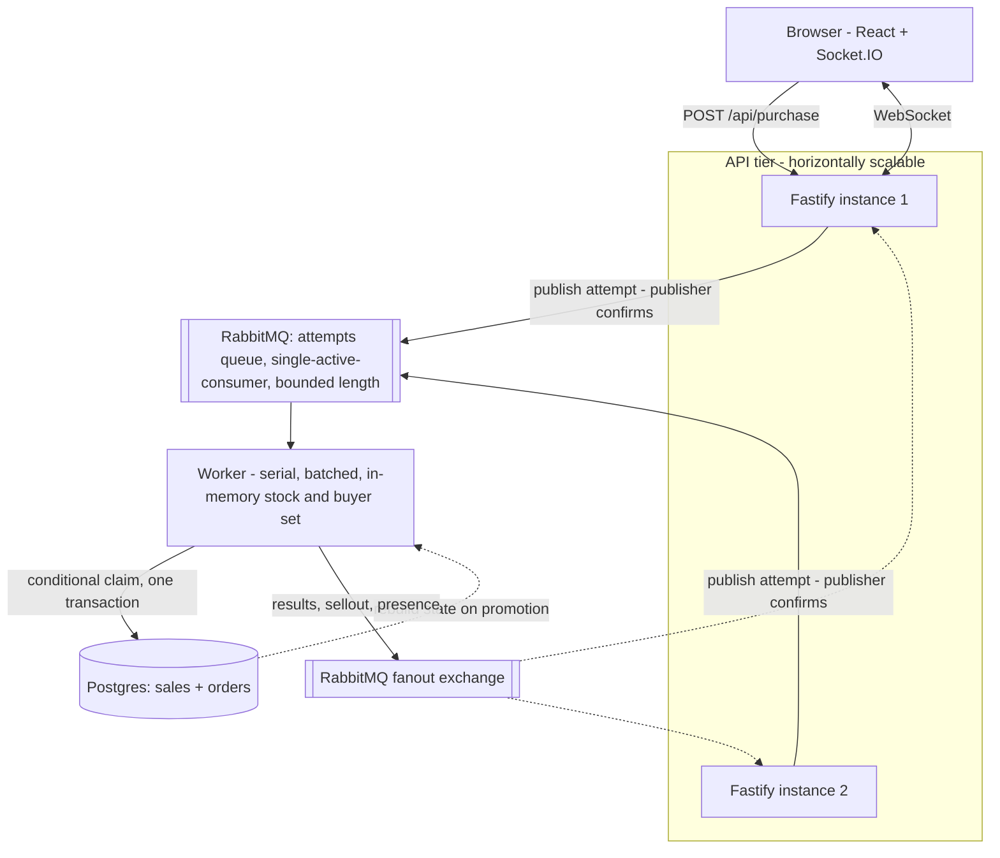

# Flash Sale — Requirement Analysis & Implementation Plan

Companion to [REQUIREMENT.md](./REQUIREMENT.md). This is the plan I intend to build against; the final `README.md` will be derived from the decisions recorded here.

## 1. What is actually being assessed

The brief is small enough to brute-force with a single Postgres row and a `SELECT ... FOR UPDATE`. That would pass the functional tests and fail the exercise. The grading criteria name *System Design*, *Correctness under load*, *Testing*, and *Pragmatism* — so the deliverable has to make three things visible:

1. **One serialization point, and it is in the right place.** Every purchase must funnel through a single ordered decision. The design question is not *whether* to serialize but *where*, and what that placement costs.
2. **A failure story.** What breaks when the component holding that decision dies, and whether the breakage is oversell (unacceptable — you sold stock you do not have) or undersell (recoverable).
3. **Tests that prove the invariant, not tests that exercise the happy path.** A stress test reporting "12k req/s, 0 errors" proves nothing. One that asserts `orders === stock` exactly, under 20× oversubscription, proves everything.

Everything below optimises for making those three legible.

## 2. Requirement analysis

### 2.1 Functional, restated as invariants

| # | Requirement | Invariant to enforce | Where enforced |
|---|---|---|---|
| 1 | Configurable sale window | No claim outside `[startAt, endAt)` | API fast-reject + worker |
| 2 | Single product, limited stock | `count(orders) <= totalStock`, always | Conditional claim statement (§4) |
| 3 | One item per user | `count(orders where user) <= 1` | Worker buyer set + `UNIQUE (sale_id, user_id)` |
| 4 | API: status / purchase / check | — | Fastify HTTP + WebSocket |
| 5 | React frontend | — | Vite + React + Socket.IO client |
| 6 | System diagram | — | Mermaid in README |

Invariants 2 and 3 get **two independent enforcers**: the worker's in-memory state for speed, and database constraints as the durable backstop. If the worker is ever wrong, Postgres refuses the write and we get an alert instead of an oversold product.

### 2.2 Ambiguities, and the decisions I am taking

The brief leaves these open. Each is a defensible judgement call; the README will state the choice and the reason.

- **Is there authentication?** No. `userId` is a client-supplied string, exactly as the brief's frontend description implies ("enter a user identifier"). The one-per-user rule is therefore enforced *per identifier*, not per human. I will say so explicitly rather than pretend otherwise, and note that in production this key would come from a verified session.
- **Is the purchase synchronous?** No — and this is the central decision. `POST /api/purchase` returns `202 Accepted` once the attempt is durably queued; the outcome arrives over a WebSocket. The brief sanctions this directly by asking for a separate "check if you secured an item" endpoint, which doubles as the reconnect path. §3 explains why the asynchrony buys more than it costs.
- **Is "already purchased" an error?** No — it is a success. Because each user may hold at most one item, `userId` is a natural idempotency key: a retried attempt resolves to the *same* order. This matters because the first thing a panicking user does is double-click.
- **Is stock exposed?** Exact remaining stock is a poll magnet and leaks sale mechanics. The status endpoint returns a coarse `availability: "plenty" | "low" | "sold_out"`, not a live counter.
- **Reservation or sale?** A claim is final, not a held reservation. There is no payment step in the brief, so a TTL'd reservation that can expire adds a class of states ("expired, stock returned") the requirement never asks for. Out of scope.

### 2.3 Non-functional targets

Concrete numbers, so the stress test has something to pass or fail:

- **Throughput:** ≥ 10k purchase attempts/sec sustained on a laptop-scale docker-compose.
- **Latency:** p99 < 100 ms from `POST` to the WebSocket result, measured end to end, for attempts that are not queued behind a burst.
- **Correctness:** zero oversell and zero double-grant at any load. Non-negotiable; this one gets asserted, not merely measured.
- **Load shedding:** when the queue saturates, the system rejects cleanly rather than growing unboundedly.

## 3. Architecture



**The queue is the concurrency control.** A single active consumer processes attempts in order, so there is no race to arbitrate — correctness comes from the topology, not from clever locking. The worker checks and claims in one database transaction, which means there is no separately-granted outcome waiting to be persisted, and therefore **no outbox and no two-system divergence**.

**Component roles:**

- **API (Fastify + Socket.IO).** Rejects what it can for free (§6), publishes the rest to RabbitMQ with publisher confirms, and holds the user's WebSocket. Horizontally scalable; the only state it holds is its own socket map.
- **RabbitMQ.** Carries purchase *attempts* (requests, not decisions) on a durable, length-bounded queue with `x-single-active-consumer`, and carries results, sellout and presence back on a fanout exchange.
- **Worker.** The sole writer. Holds stock and the buyer set in memory, batches claims into transactions, and publishes each outcome to the fanout. Rebuilds its state from Postgres on startup or promotion.
- **Postgres.** System of record and the durable enforcer of both invariants.

**Why the queue, and not a distributed cache making the decision:** the alternative I costed first was an atomic Redis Lua script granting stock synchronously, with a stream handing off to a persistence worker. It is faster (§13) but strictly worse on correctness: a grant lives in Redis before it reaches Postgres, so a crash in that window means a user was told "confirmed" and holds nothing. In the design below, a result is only ever published **after** the transaction commits — the system never tells a user something false. The spike that evaluated it is kept at [`prototype/redis-grant/`](./prototype/redis-grant/).

**Why not claim directly in the API request:** because contention on the stock row is measurably catastrophic. With 50 connections competing for the same row (§4), throughput rose 7% over a single connection while mean latency rose 46×. Serializing in the queue converts that convoy into an ordered stream, and lets the worker batch.

| Rejected alternative | Why |
|---|---|
| `UPDATE ... WHERE remaining > 0` from N API instances | Lock convoy. Measured: 899 tps at 55.6 ms mean vs 835 tps at 1.2 ms single-connection. |
| Application-level mutex / in-process counter | Breaks with more than one API instance, which is exactly the scalability the brief asks for. |
| Optimistic concurrency with retries | Under heavy contention almost every attempt retries; wasted work grows with load, which is backwards. |
| Redis Lua grant + stream to Postgres | Faster, but introduces a window where a confirmed user has no durable order. See `prototype/redis-grant/`. |

## 4. The critical path: one conditional claim

The worker's claim must write the order **only if** it actually took a unit. Doing this as a separate `UPDATE` then `INSERT` invites the bug where the update matches no rows and the insert happens anyway. One statement removes the possibility:

```sql
WITH claimed AS (
  UPDATE sales SET remaining = remaining - 1
  WHERE id = $1 AND remaining > 0
  RETURNING id
)
INSERT INTO orders (sale_id, user_id)
SELECT $1, $2 FROM claimed
ON CONFLICT (sale_id, user_id) DO NOTHING
RETURNING id;
```

An empty result means "no unit taken", for either reason — sold out, or this user already holds one. The worker distinguishes the two from its in-memory buyer set, which is cheap and never authoritative.

**This is already verified.** A spike at [`prototype/postgres-claim/`](./prototype/postgres-claim/) runs it against a real Postgres 18 under `pgbench`. All numbers below are measured, not estimated:

| Scenario | Result |
|---|---|
| 20 000 attempts (50 connections) against stock of 1000 | **exactly 1000 orders, 1000 distinct users, `remaining` = 0** — no oversell |
| Serial worker, 1 claim per transaction | 835 claims/s, 1.2 ms mean |
| Serial worker, 100 claims per transaction | **~23 650 claims/s**, 4.2 ms per batch |
| 50 connections contending on the stock row | 899 claims/s, **55.6 ms mean** |
| Post-sellout rejections | ~17k/s even when they reach Postgres |

Three conclusions drive the rest of the design:

1. **Batching is not an optimisation, it is the design.** 835/s would miss the 10k/s target by an order of magnitude; batching 100 claims per transaction clears it 2.4×. The cost is fsync per commit, so amortising the commit is where all the throughput lives.
2. **Contention is real and the queue is what avoids it.** 50× the concurrency bought 7% more throughput and 46× the latency. That is the lock convoy, measured, and it is the strongest argument for serializing upstream.
3. **The rejection path is cheap even at its worst.** Post-sellout rejections sustained ~17k/s *while still hitting Postgres*. Since §6 rejects them in memory instead, the real ceiling is far higher — and the expensive path is bounded by `totalStock`, not by traffic.

## 5. Durability and failure modes

| Failure | Behaviour | Severity |
|---|---|---|
| API instance dies | Sockets drop. Client reconnects to another instance and re-syncs via `GET /api/purchase/:userId`. An already-queued attempt still gets processed; the result is waiting. | None |
| Worker dies mid-batch | Uncommitted transaction rolls back; messages were never acked, so RabbitMQ redelivers them to the newly promoted consumer. | None |
| Worker dies after commit, before ack | Redelivery re-runs the claim; `ON CONFLICT DO NOTHING` makes it a no-op and the result is re-published. Idempotent. | None |
| Postgres down | Worker stops acking; the queue backs up to its bound, then the API sheds load with `503`. No incorrect answers are given. | Degraded, self-healing |
| RabbitMQ down | No attempts accepted; API returns `503`. This is the hard dependency of the design. | Outage, correct |
| Result message lost | User's socket shows nothing; the reconnect/poll path resolves it from Postgres. | Cosmetic |

**The property worth stating plainly: a user is never told "confirmed" unless the row is committed.** Results are published after the transaction, so there is no window in which the system's answer and its durable state disagree. That is the main thing this design buys over the Redis alternative, and it is why RabbitMQ being a hard dependency is an acceptable trade — an outage is honest, whereas a false confirmation is not.

Required for the above to hold:
- **Publisher confirms** on the API side. Without them a "published" attempt can vanish and the user waits forever for a result that will never come.
- **Durable queue, persistent messages**, and quorum queues if surviving a broker node loss matters.
- **Bounded queue** via `x-max-length` with `overflow: reject-publish`, so saturation becomes a clean `503` rather than unbounded memory growth and unbounded latency.

## 6. Early rejection: what never reaches the queue

Most flash-sale traffic is doomed, and the cheapest request is the one that never gets published. Three filters at the API layer, in increasing cost:

1. **Window check — free.** `startAt`/`endAt` are static config, so the entire pre-sale rush and everything after the end is rejected in process with zero I/O.
2. **Sellout flag — one message, then free.** When the worker takes the last unit it publishes `SOLD_OUT` once to the fanout; every API instance sets a local boolean and rejects in memory from then on. This is safe because **sellout is monotonic**: it only ever flips one way, and only the sole writer can flip it. A stale flag can only ever be wrong in the harmless direction (enqueueing a doomed attempt that the worker rejects), never in the direction that wrongly rejects a buyer.
3. **Periodic refresh — one row per instance per second.** Each instance re-reads `sales.remaining` on a timer, covering instances that booted late or missed the fanout message. This is why `remaining` is a denormalized column rather than a `count(*)`: it keeps the refresh a single primary-key read.

Deliberately **not** filtered at the API layer: "already purchased". It needs a per-user lookup, the frontend already disables the button while a request is in flight, and the worker rejects duplicates from its in-memory buyer set for almost nothing. Paying a database round trip per request to catch a rare case would be a bad trade.

Rate limiting still applies on top: a per-IP and per-user token bucket, rejecting with `429`. Not in the brief, but an endpoint this attractive without a limiter is a conspicuous omission.

## 7. API surface

| Method | Path | Returns |
|---|---|---|
| `GET` | `/api/sale` | `{ status, availability, startAt, endAt, serverTime, viewers }` |
| `POST` | `/api/purchase` | `202 { status: "queued", attemptId }` · `409 { status: sold_out\|not_started\|ended }` · `429` · `503` |
| `GET` | `/api/purchase/:userId` | `{ status: none\|confirmed, orderId?, purchasedAt? }` — reconnect source of truth |
| `GET` | `/healthz` `/readyz` `/metrics` | liveness, readiness, Prometheus |

WebSocket events pushed to the client:

| Event | Payload |
|---|---|
| `purchase:result` | `{ attemptId, status: confirmed\|already_purchased\|sold_out, orderId? }` |
| `sale:status` | `{ status, availability }` — broadcast on change |
| `sale:viewers` | `{ count }` — aggregated presence, every few seconds |

`GET /api/sale` is cached in process and refreshed on the same 1 s timer as the sellout check, so the highest-volume endpoint costs no I/O per request. `serverTime` is returned so the frontend countdown does not trust the client clock.

## 8. WebSocket transport and cross-instance delivery

**Library: Socket.IO**, for reconnection, heartbeats and acknowledgements — all of which matter here because a socket dropping mid-purchase is routine, and hand-rolling reconnect on raw `ws` is a meaningful chunk of work for no credit.

**But not its Redis adapter.** The usual way to broadcast across instances is `@socket.io/redis-adapter`, which would reintroduce Redis purely as a message bus — undoing the simplification this design just bought. RabbitMQ is already present and does the same job:

- **Results target exactly one user.** Each API instance consumes the fanout, looks up its own local `Map<userId, socket>`, and delivers or discards. No cross-instance room broadcast is needed at all.
- **Presence and status are broadcasts**, so each instance simply emits locally to its own connections on receiving the fanout message.

**Presence is aggregated, never exact.** Exact per-connection accounting broadcast to everyone is O(N²). Instead each instance publishes its own connection count to the fanout every few seconds; every instance keeps a `{instanceId: count, seenAt}` map, expires stale entries, and sums locally. O(N), no central aggregator, and the number is decorative so approximation is free. This is the "X other people are looking at this" feature — not required by the brief, but it is what a real flash sale shows, and the WebSocket is already there.

## 9. Data model

```sql
CREATE TABLE sales (
  id          TEXT PRIMARY KEY,
  total_stock INTEGER NOT NULL CHECK (total_stock >= 0),
  remaining   INTEGER NOT NULL CHECK (remaining >= 0),   -- denormalized; keeps §6 a PK read
  start_at    TIMESTAMPTZ NOT NULL,
  end_at      TIMESTAMPTZ NOT NULL,
  CHECK (end_at > start_at)
);

CREATE TABLE orders (
  id         UUID PRIMARY KEY DEFAULT gen_random_uuid(),
  sale_id    TEXT NOT NULL REFERENCES sales(id),
  user_id    TEXT NOT NULL,
  created_at TIMESTAMPTZ NOT NULL DEFAULT now(),
  UNIQUE (sale_id, user_id)          -- the durable one-per-user backstop
);
CREATE INDEX ON orders (sale_id);
```

`CHECK (remaining >= 0)` is the durable anti-oversell backstop: even a logic bug cannot drive stock negative, because Postgres will abort the transaction. Combined with the `UNIQUE` constraint, both headline invariants are enforced by the database independently of any application code.

The worker rebuilds its in-memory state on startup or promotion with two queries — `SELECT remaining FROM sales` and `SELECT user_id FROM orders WHERE sale_id = $1`. Both are bounded by `totalStock`, so promotion is fast.

## 10. Frontend

Deliberately small — the brief asks for a demonstration, not a storefront. Vite + React + TypeScript, one page:

- Sale status and countdown driven off `serverTime`.
- A `userId` input, persisted to `localStorage` so a refresh does not lose your identity.
- A "Buy Now" button, disabled outside the active window and while a request is in flight.
- An explicit **queued** state between `202` and the WebSocket result — this is the honest representation of what the system is doing, and it is where a real flash sale shows a spinner.
- Terminal states: *confirmed* (with order id), *already purchased*, *sold out*, *not started*, *ended*, *try again* (on `503`).
- Live viewer count from `sale:viewers`.
- On mount and on every reconnect, it calls `GET /api/purchase/:userId`, so a dropped socket never loses a result.

## 11. Testing strategy

**Unit (Vitest).** Window/status derivation, the monotonic sellout flag state machine, presence aggregation and stale-instance expiry, result-to-UI-state mapping. Fast, no I/O.

**Integration (Vitest against real RabbitMQ and Postgres via docker-compose).** The claim statement, worker batching, consumer failover, and — importantly — **redelivery idempotency**: ack a message only after commit, kill the worker between the two, and assert the redelivered message produces no second order.

**The two decisive tests**, run through the full stack rather than against the database alone:

1. *No oversell.* Stock = 1000, 20 000 attempts from 20 000 distinct users. Assert exactly 1000 `confirmed`, 19 000 rejected, and exactly 1000 rows in `orders` once the queue drains.
2. *No double-grant.* 1000 concurrent attempts from **one** user. Assert exactly one order and `remaining` decremented by exactly one.

Both already hold at the SQL layer — `prototype/postgres-claim/` demonstrates 20 000 attempts producing exactly 1000 orders — so the integration versions are testing the queue and worker wiring, not the claim itself.

**Stress (k6).** Ramp to high concurrency over ~60 s with thresholds encoded as pass/fail, driving HTTP for attempts and holding WebSocket connections for results, so the measured latency is genuinely end-to-end rather than time-to-`202`. A teardown asserts the same invariants at realistic load. Results and their interpretation go into the README.

**Load shedding is a test case, not an afterthought.** Drive past the queue bound and assert the API returns `503` cleanly, memory stays flat, and no attempt is silently dropped.

## 12. Repo layout and tooling

```
apps/
  api/        Fastify + Socket.IO, early rejection, publisher confirms
  worker/     single-active consumer, batched claims, result publishing
  web/        Vite + React frontend
packages/
  core/       domain types, status logic, config schema, shared message contracts
tests/
  integration/
  stress/     k6 scenarios
docs/
  REQUIREMENT.md  PLAN.md  prototype/
docker-compose.yml   README.md
```

pnpm workspaces. Fastify over Express for throughput and schema-based validation; `socket.io`; `amqplib` for RabbitMQ; `pg` with plain SQL rather than an ORM, since the claim is a hand-written CTE an ORM would only obscure; `zod` for config; `pino` for logging; `prom-client` for metrics. One `docker compose up` brings up RabbitMQ, Postgres, API, worker and frontend.

Two infrastructure components, not three — dropping Redis is a direct consequence of the queue owning the decision, and it is worth calling out in the README as a simplification rather than leaving it unremarked.

## 13. Implementation phases

Ordered so the risky part is proven first. Estimates are for a focused build.

| # | Phase | Output | Est. |
|---|---|---|---|
| 0 | Scaffold | pnpm workspaces, TS config, lint, docker-compose, CI | 1–2 h |
| 1 | **Claim core** | Schema, migrations, claim statement, worker batching + both invariant tests — *statement already drafted and verified, §4* | 2 h |
| 2 | Queue wiring | amqplib, publisher confirms, single-active-consumer, bounded queue, redelivery idempotency tests | 2–3 h |
| 3 | API | Fastify routes, three-tier early rejection, rate limiting, status cache | 2–3 h |
| 4 | WebSocket | Socket.IO, fanout consumption, local socket map, presence aggregation | 2–3 h |
| 5 | Frontend | React page, queued state, terminal states, viewer count | 2–3 h |
| 6 | Stress | k6 scenarios incl. WebSocket result latency and load shedding | 2–3 h |
| 7 | Write-up | README, Mermaid diagram, trade-offs, run instructions, stress summary | 2 h |

If time runs short, phases 5–6 get trimmed before 1–2 give up any ground. The presence feature (§8) is the first thing to cut — it is the one piece not traceable to a requirement.

## 14. Explicitly out of scope

Named in the README so their absence reads as a decision rather than an oversight: authentication and identity verification, payment and fulfilment, TTL'd reservations with expiry, multiple products or variants, waiting-room admission control, bot detection beyond rate limiting, multi-region deployment, and live cloud deployment (the brief waives it).

## 15. Extension: what the next 10× would need

The single active consumer is the ceiling, and §4 puts it at ~23 650 claims/s batched. Two routes past it, in order of preference:

1. **Shard the stock.** Partition `sales` into K bucket rows with one active consumer per partition, routed by a hash of `userId`. Add stock stealing when a bucket empties, so the tail of the sale does not strand inventory in a quiet shard. The claim statement is unchanged; only the routing key and the rebalance logic are new.
2. **Admission filter in front of the queue.** Put the Redis Lua grant from [`prototype/redis-grant/`](./prototype/redis-grant/) — measured at ~210 000 ops/s — ahead of RabbitMQ purely to reject losers in sub-millisecond time, letting only winners through to the authoritative transaction. This reintroduces Redis, so it is worth doing only if the stress numbers demand it. The transactional core does not change.

Neither is built. Both are reachable without discarding the current design, which is the point.

## 16. Open questions

Nothing here blocks a start; each has a stated default I will proceed under.

1. **Is a `docker compose up` dependency acceptable to the reviewer**, or must everything run with `npm install && npm start` alone? *Default: compose, with in-memory adapters for the queue and store so unit tests run with no containers.*
2. **How long is the exercise meant to take?** The phasing above is ~17 hours. *Default: build phases 0–4 and 7 to a high standard, then 5–6 as time allows.*
3. **Should the stress test run in CI?** It needs sustained load and will be slow and noisy on shared runners. *Default: the two invariant tests run in CI; the full k6 run is manual, with its results committed.*
4. **How large is the batch window?** 100 claims per transaction is measured, but the right value trades latency against throughput and depends on burst shape. *Default: batch by size **or** a few milliseconds of wall time, whichever comes first, and tune against the stress results.*
